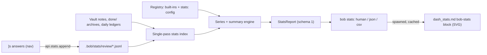

# Plan: Daily Stats

## Context

Bryan asked for a way to track daily habits and stats, each boiling down to one number
per day:

1. morning GTD review tasks processed with the `]s` walk;
2. Pomodoro hours and minutes worked (already shown by an inline query on each daily
   note's `## Pomodoros` heading);
3. tasks completed;
4. tasks created;
5. any other v1 metrics worth tracking.

New metrics must be easy to add later, any metric must be easy to visualize over an
adjustable period, and the result must be intuitive, reliable, and beautiful. Bryan
reviewed and agreed with every requirement in the consolidated research report
`research:202610/bob_daily_stats/bob_daily_stats.md`, the design source for this plan.
Read it with `sase artifact read` before starting any phase; this plan settles its open
questions and supersedes it where they differ.

### The idea in one sentence

> **Derive what the vault keeps; record only what the vault forgets; define every metric
> once, in bob; draw it twice (terminal and Obsidian) from the same JSON.**

### Facts the design rests on (verified while planning)

- **Review stamps evaporate.** `[fresh::]` keeps only the latest date, and lanes are
  re-reviewed daily (`pending_interval: 1`, `next_interval: 1`), so a stamp-derived
  "reviewed" count is wrong within 24 hours. Stamps also miss non-stamping answers
  (Ctrl+Enter close, drop, checklist). The walk's answers are the only thing that must
  be **recorded**; everything else is **derived**.
- **The walk already knows what an answer is**, but only in memory
  (bob-navigation-hotkeys `addReviewAnsweredKeys`, `src/536-plugin-review-advance.js`).
  A Ctrl+Shift+M move is not an answer (`537-plugin-review-move-park.js` never records
  one).
- **Every closed Pomodoro carries `[t::]`.** Σ`t` over closed ledger rows equals the
  heading query exactly. bob-cli already sums it:
  `capture_pomodoros::completed_summary_for` (`[t::]` first, range fallback via
  `capture::duration_from_range_text` / `capture_pomodoros_agenda::range_minutes`).
- **Task dates exist but `RichTask` hides two of them.** `dataview/tasks/task.rs` `Task`
  parses `done` (`[completion::]`) and `cancelled`; `RichTask` (`dataview/tasks/mod.rs`)
  exposes neither. `StatusType::is_done()` is broad (DONE | CANCELLED | NON_TASK); stats
  must test the status **type** string (`"DONE"`, `"CANCELLED"`).
- **Raw task counts are polluted**: recurring chore instances (6–10/day), the daily
  template's `- [*] #task [[gtd_daily]] … ^gtd` Task Link (one per day), and bulk triage
  spikes.
- **`bob nightly` archives closed tasks into `done/<path>_done.md`**, so history lives
  in `done/`; `collect_done::link_repair::source_relative_path_from_archive` maps an
  archive back to its source note. Archiving must never change a stat.
- **The Tasks query engine is too heavy** (`bob query --tasks` ≈ 6 s, 1.6 GB); one
  `TaskIndex::read` pass is ≈ 0.3 s (`bob plan` builds it twice in 0.63 s). Stats needs
  its own single pass.
- **Plugins persist nothing today** and never spawn processes; they read
  `~/.config/bob/config.yml` through optional `fs`/`os` requires
  (`planRequireOptionalNodeModule`). There is no settings tab anywhere. The journal is
  the first plugin-written data file and the Stats block is the first plugin to spawn
  `bob` — the Obsidian twin of `decisions:mac-capture-is-a-thin-client`.
- **Custom plugins are desktop-only in practice** (gitignored, deployed per machine by
  `bob plugins sync`), so every machine that renders Stats has `bob` installed.
- **The vault already tracks machine data in a dot-dir**: `.gitignore` allowlists
  `!/.bob/gkeep/imports/*.json` and `bob vault-sync` stages with `git add -A`.
- **The live walk tier strings** are
  `pre, new, projects, pending, next, recurring, tickler, rotten, post`
  (`FRESHNESS_TIER_ORDER`, bob-ledger-tools `src/100-freshness-evaluate.js`). The
  `decisions:review-walk-is-tiered` roster is stale (it still lists REFERENCES); that is
  tracked by memory bead `bob-cli-5q` and is out of scope here.
- **Palette check (dataviz validator, re-run while planning):** the research's
  light-mode Done hue `#1baf7a` fails 3:1 contrast on white (2.82:1); `#16a070` passes
  every check in light mode, so this plan uses it. Adjacent pairs pass in both modes;
  Reviewed violet and Created blue fail as an all-pairs comparison, so **they never
  share a plot**.

### Design principles

1. **Zero daily effort.** No prompts, no manual entry, no new habit. Bryan's 826-file
   zorg habit log decayed into "Skipping …" entries and stopped; automatic capture is
   the only kind that lasts.
2. **One definition per metric, in bob.** bob-cli computes every value, summary, and
   display string. The Obsidian block and the terminal only draw what `bob stats`
   returns. No JavaScript mirror of task semantics.
3. **Missing is never zero.** Every day carries a typed value or `null`, plus a quality
   flag and a reason. "No data" never looks like "bad day".
4. **A weekly instrument, not a daily scoreboard.** No streaks, no targets, no judgment
   colors on volumes, no number on the dash. Today is drawn hollow and never enters a
   median or a delta.
5. **Every output has a counterweight.** Reviewed ↔ Keep rate and Review time; Done ↔
   Created and Net flow. A count that can be gamed always sits next to the number that
   exposes the gaming.
6. **Calm, theme-native, accessible.** Fixed validated hue per metric, Obsidian text
   tokens for all text, thin marks, a table for exact numbers, keyboard parity with
   hover.

## The v1 metric catalog

A v1 metric must be automatic, answer a question Bryan already asks (the weekly prune or
a decision's reopen trigger), and either be a counterweight or have one. Everything else
is "later".

### Headline metrics (the overview row, in this order)

| ID              | Label         | Unit                        | Definition                                                                                                                                                                                                                                                 | Parts             | Color  |
| --------------- | ------------- | --------------------------- | ---------------------------------------------------------------------------------------------------------------------------------------------------------------------------------------------------------------------------------------------------------- | ----------------- | ------ |
| `worked`        | Worked        | minutes                     | Σ minutes of **closed** (`[x]`/`[X]`) Pomodoro rows under `## Pomodoros` in the canonical daily note `YYYY/YYYYMMDD.md` for D, using `completed_summary_for` (`[t::]`, else the time range with a `partial` quality). Open rows are plans and never count. | `theme`           | orange |
| `reviewed`      | Reviewed      | count                       | Distinct walk row keys with ≥ 1 journaled answer on day D in **decision tiers** (every tier except `pre` and `post`).                                                                                                                                      | `tier`, `outcome` | violet |
| `done`          | Done          | count                       | Non-recurring tasks whose status **type** is `DONE` and whose `[completion::]` date is D, excluding the daily-note `^gtd` Task Link.                                                                                                                       | `kind`, `note`    | green  |
| `created`       | Created       | count (neutral)             | Non-recurring tasks whose `[created::]` date is D, any status, same exclusions.                                                                                                                                                                            | `kind`, `note`    | blue   |
| `net`           | Net flow      | signed count (down is good) | `created − done − dropped`. Shown with the words "growing" / "shrinking", never a judgment color.                                                                                                                                                          | —                 | gray   |
| `review_closed` | Review closed | bool                        | The `#gtd #post` **Morning review** checklist chore was completed on D (see the checklist kind).                                                                                                                                                           | —                 | violet |

### Secondary metrics (detail views, the page, `bob stats show`)

| ID            | Label       | Unit    | Definition                                                                                        | Why it earns a place                                                               | Color  |
| ------------- | ----------- | ------- | ------------------------------------------------------------------------------------------------- | ---------------------------------------------------------------------------------- | ------ |
| `dropped`     | Dropped     | count   | Non-recurring tasks with status type `CANCELLED` and `[cancelled::]` = D, same exclusions.        | Pruning is output; it feeds Net flow.                                              | gray   |
| `habits`      | Habits      | ratio   | `#gtd #pre` checklist chores met on D ÷ chores due on D; parts give a per-chore grid.             | Measures the "PRE skipped on most mornings" reopen trigger.                        | green  |
| `keep_rate`   | Keep rate   | ratio   | Among PENDING + NEXT rows answered on D (last answer per key), the share whose answer was `keep`. | Measures the "lane keep rate above 90%" reopen trigger; counterweight to Reviewed. | violet |
| `review_time` | Review time | minutes | `worked` restricted to sessions themed `GTD`.                                                     | The cost side of the ritual; counterweight to Reviewed.                            | orange |
| `sessions`    | Sessions    | count   | Closed Pomodoros on D.                                                                            | Separates one long slog from many fragments.                                       | orange |

`kind` parts for task metrics: `prj` (block ID `prj`), `ref` (tag `#ref` or block ID
`ref`), else `task`. `note` parts use the task's residence note (archives mapped back to
their source note), top five plus `other` in summaries.

> [!decision] ref_in_done = no Task metrics (`done`, `created`, `dropped`, and therefore
> `net`) exclude tasks tagged `#ref` or carrying block ID `ref` by default, and their
> `kind` part never shows `ref`. The `tasks` kind's `kind:` filter still lets a custom
> metric count reading tasks alone (`kind: ref`).

### Later (documented in `docs/stats.md`, not built)

- Lane sizes at end of day and walk-due-at-start — point-in-time state needing a nightly
  `snapshot` kind recorded by `bob nightly`.
- Day start (first closed session's start time).
- Plan follow-through (needs a careful definition; open placeholders are a lineup, not a
  promise).
- Manual metrics (energy, sleep, exercise) — **already supported** by the `field` kind;
  none ship enabled and nothing ever prompts for them.
- An approximate review backfill from vault git history (Oct 4 → ship): not built; the
  journal starts clean and shows "Tracking since …".

Rejected: stamp counts, productivity scores, tasks per hour, automated "insights",
streak counters, commits/words/lines, time in Obsidian.

## Data model and shared semantics (bob-cli owns all of this)

### Day values

Every metric yields, for each date D in the range:

- `value`: integer or `null`. Units: `count` (≥ 0), `signed` (any integer), `minutes`,
  `bool` (0/1), `ratio` (basis points 0–10000, plus `num` and `den` integers so periods
  pool correctly).
- `display`: the formatted value (`4h 05m`, `45m`, `0m`, `12`, `−6`, `+9`, `met`,
  `missed`, `82%`, or `–` for null). Minutes ≥ 60 render `Hh MMm`; below 60, `Nm`.
- `quality`: `ok` · `partial` (computed with a known fallback, e.g. a range-derived
  Pomodoro without `[t::]`) · `missing` (expected input absent — no daily note, journal
  gap, nothing due) · `not_tracked` (before the metric's `since`).
- `reason`: display-ready text for every non-`ok` quality ("no daily note", "before
  tracking started on Oct 12", "review closed but no answers were recorded").
- `provisional`: true only for today.
- `parts`: `{dimension: {key: value}}` breakdowns (omitted when empty).
- `rolling_median`: trailing median (7 days for day grouping, 4 buckets for week, 3 for
  month) over non-provisional, non-null values; `null` unless at least half the window
  has data.

### Ranges, today, and grouping

- Presets `7d`, `4w`, `3m`, `1y`, `all`, plus `Nd`, `Nw`, `Nm`, `Ny` and explicit
  `YYYY-MM-DD..YYYY-MM-DD`. Month and year presets snap to whole weeks (`3m` = 13 weeks
  = 91 days, `1y` = 52 weeks) so every window holds the same number of each weekday.
  **Default `4w`** (config `stats.range` overrides).
- A preset window is the N **complete** days ending **yesterday**, plus **today as one
  provisional point** (drawn hollow, excluded from every summary). An explicit range is
  inclusive; an end after today clamps to today, and today is then provisional.
- `--offset N` shifts the window back N whole windows (the page's ‹ ›). Shifted windows
  never contain today.
- The prior period is the equal-length window immediately before.
- `all` starts at the earliest `since` among the selected metrics (respecting a global
  `stats.since` floor if configured).
- Grouping `auto` → `day` up to 91 days, `week` up to 371 days, `month` beyond. Weeks
  are ISO (Monday start); buckets clipped by the range edges are flagged
  `partial: true`. Grouped values: counts/minutes/signed sum, ratios pool `num/den`,
  bools count days met (`display` "5 of 7").

### Summaries (complete days only)

- **Headline**: `count`/`minutes`/`signed` → median per day (`4h 50m /day`); `bool` →
  days met of days with data (`5 of 7 days`); `ratio` → pooled ratio over the range
  (`82%`).
- Also `total`, `mean`, `p25`, `p75` (the gray "normal" band), `days_with_data`,
  `days_met`, the prior period's headline, and a **delta**:
  - counts/minutes: `▲ 6%` / `▼ 12%`; `≈ same` within ±1%; ratios ≥ 2 or ≤ 0.5 as
    `▲ 2.5×` / `▼ 0.4×`; a zero or null prior → `new` / `–`.
  - ratio: percentage points, `▲ 4 pts`.
  - bool: days, `▲ 2 days`.
  - net: the words `shrinking` / `growing` / `flat` from the range total's sign.
  - Every delta also carries `words` for accessibility ("up 6% vs the prior 4 weeks").
    Deltas are never colored; Created's delta is explicitly neutral.

### The `stats:` config section (`~/.config/bob/config.yml`)

```yaml
stats:
  range: 4w # default window for bob stats and the page
  overview: [worked, reviewed, done, created, net, review_closed]
  hide: [] # metric ids hidden from lists; never deleted
  # since: 2026-06-01             # optional global floor for derived history
  # bob_path: ~/.cargo/bin/bob    # Obsidian only: where the Stats block finds bob
  metrics:
    sase_time: { label: SASE time, kind: pomodoro, themes: [SASE] }
    job_done: { label: Job tasks done, kind: tasks, event: done, in: [job] }
    floss: { label: Floss, kind: checklist, match: "Floss teeth", measure: bool }
    energy: { label: Energy, kind: field, field: energy, unit: count }
```

- A metric is
  `id → {label, kind, …kind params, unit?, direction?, color?, since?, description?}`.
  `color` is a palette **slot** (`orange | violet | green | blue | gray`), never a hex,
  so every rendered hue stays validated. Defaults come from the kind (pomodoro → orange,
  journal → violet, checklist and done → green, created → blue, formula/field/dropped →
  gray).
- **Built-ins are written in code as the same config entries**, so every built-in
  exercises the user path. A user entry with a built-in id **replaces** that built-in
  (`bob stats metrics` marks it `redefined`) — this is how Bryan would widen
  `review_time` to `[GTD, ADMIN]` or set `reviewed`'s `tiers: all`.
- Validation follows `config/plan.rs`: a non-mapping `stats:` or a malformed
  `range`/`overview`/ `since` is a config error (exit 2, message
  `stats.<key> in <path> must …`). **One invalid metric entry never breaks the others**:
  it is dropped with a warning (`stats.metrics.<id>.<key> …`) surfaced in JSON, the
  terminal, and on the page. Unknown keys are ignored (`bob_path` is plugin-only).
  Formula cycles and references to unknown ids are per-metric warnings.

### Metric kinds (v1)

| Kind        | Parameters                                                                                                                                                         | Semantics                                                                                                                                                                                                                                                                                                                                                                                                                                                                                                           |
| ----------- | ------------------------------------------------------------------------------------------------------------------------------------------------------------------ | ------------------------------------------------------------------------------------------------------------------------------------------------------------------------------------------------------------------------------------------------------------------------------------------------------------------------------------------------------------------------------------------------------------------------------------------------------------------------------------------------------------------- |
| `pomodoro`  | `measure: minutes \| count` (default minutes), `themes`, `exclude_themes`                                                                                          | Closed ledger rows of D's canonical daily note. A session's theme is its canonical (uppercased) name; a composite `A + B` name (split with `plan_budget::split_components`) shares minutes equally across components, remainder to the first. Unnamed sessions use theme `(unnamed)`. No canonical daily note or no `## Pomodoros` section → `null`/`missing`; a section with no closed rows → 0.                                                                                                                   |
| `tasks`     | `event: created \| done \| dropped`, `tags_any`, `tags_all`, `in: [note…]`, `kind: task \| prj \| ref`, `recurring: exclude \| only \| include` (default exclude)  | Status type `DONE` for done, `CANCELLED` for dropped, any status for created. Always excludes the canonical daily note's `^gtd` Task Link. Residence for `in:` maps `done/` archives to their source note, then matches by path or basename, including notes whose frontmatter `parent` chain reaches a listed note (resolve with `vault_links::NoteIndex`). Every day ≥ `since` has a value (0 when nothing happened).                                                                                             |
| `checklist` | `tags` (all required, exact whole tokens, case-insensitive), `match` (case-insensitive substring of the normalized description), `measure: ratio \| count \| bool` | A **chore** is the normalized description (inline fields, tags, block ID stripped; whitespace collapsed; lowercased). Instance _i_ is **outstanding** on days `[scheduled_i (else created_i), completion_i]`, open instances through today. A chore is **met** on D if an instance has completion D, **due** on D if met or outstanding. Ratio = met/due, count = met, bool = all due chores met (`null`/`missing` when nothing is due). Recurring instances are the point here, so no recurring exclusion applies. |
| `field`     | `field`, `source: frontmatter \| inline \| either` (default either), `unit: count \| minutes \| bool`                                                              | Reads only D's canonical daily note. Integers, durations (`30m`, `1h 30m`), and booleans (`true/false/yes/no`). Absent → `null`/`missing`.                                                                                                                                                                                                                                                                                                                                                                          |
| `formula`   | `expr` over metric ids, integer literals, `+ − * / ( )`; `unit` (default count)                                                                                    | `null` if any input is `null`; quality is the worst input quality; division rounds half away from zero and `/0` is `null`.                                                                                                                                                                                                                                                                                                                                                                                          |
| `journal`   | `select: reviewed \| keep_rate`, `tiers: decision \| all \| [list]`                                                                                                | Built-in selectors over the review journal (below). Not user-extensible beyond `tiers` in v1.                                                                                                                                                                                                                                                                                                                                                                                                                       |

`since` per metric is explicit config, else derived: the earliest day the kind's inputs
exist (first canonical daily note with a `## Pomodoros` section; earliest valid task
date; first checklist instance; first daily note with the field; first journal event).
Days before `since` are `not_tracked`. Tasks with missing, malformed, or future dates
are never assigned to a day; they are counted once in `health` as a series limitation.

## The review journal (the one new writer)

### Location and format

- `.bob/stats/review/YYYY-MM.<host>.jsonl` in the vault — one file per month (from
  `day`) per host. Each host appends only to its own file, so git never conflicts;
  readers union every file.
- `<host>` = `os.hostname()` lowercased, cut at the first `.`, non-`[a-z0-9-]` → `-`,
  trimmed; fallback `host`.
- Vault `.gitignore` gains `!/.bob/stats/review/*.jsonl` next to the gkeep allowlist
  line, with a comment, so `bob vault-sync` carries the journal between athena, apollo,
  and the MacBook.
- Expected volume: 50–80 lines a day, single-digit MB a year.

### Event schema v1 (one JSON object per line, written in one append call)

```json
{
  "v": 1,
  "ts": "2026-10-12T05:41:07-04:00",
  "day": "2026-10-12",
  "host": "apollo",
  "kind": "review.answer",
  "tier": "next",
  "outcome": "keep",
  "key": "sase.md#fix-failed-agents",
  "plugin": "bob-navigation-hotkeys@2.19.0"
}
```

- `day`: the walk's day (landing day / stamp `dateText`), never re-derived from the
  clock.
- `tier`: the evaluator's tier string verbatim (`reviewEntryMachineTier`); `key`: the
  walk's own row key verbatim (`reviewQueueEntryKey`: `path#blockid` or `path:line`).
- `outcome` vocabulary v1:
  `keep · done · drop · defer · sequence · lane · route · today · card · checklist · decay:not_now · decay:level · decay:less_often · decay:reword · decay:drop · decay:keep`.
  Readers keep unknown outcomes (part `other`) so the vocabulary can grow additively.

### What gets journaled (the writer decides; every journaled line is an answer)

| Path (bob-navigation-hotkeys)                                                               | Journaled when                                                                                                                                                                                                                           | `outcome`                                                                                                                                                                                                                               |
| ------------------------------------------------------------------------------------------- | ---------------------------------------------------------------------------------------------------------------------------------------------------------------------------------------------------------------------------------------- | --------------------------------------------------------------------------------------------------------------------------------------------------------------------------------------------------------------------------------------- |
| `continueReviewWalkAfter(origin, outcome)` (`536`)                                          | Origin not stale, `outcome` non-null, `reviewOutcomeResolves` true. One event for the **landed** row (`origin.key`, `origin.tier`, `origin.day`).                                                                                        | `complete` → `done`; `lane` → `lane`; `route` → `route`; `link-today` → `today`; `card` → by the after-line: `[x]`/`[X]` → `done`, `[-]` → `drop`, scheduled moved past today → `defer`, new `dependsOn` → `sequence`, otherwise `card` |
| `finishFreshStamp` (`530`; Alt+F, Ctrl+Alt+F)                                               | The stamped refs include the current walk row (`reviewWalkCurrent`/`reviewLanding` path + exact pre-stamp text, as `reviewRefsTouchWalkCurrent` does) and the stamp day equals the walk day. Tier from the matching `queueBefore` entry. | `keep`                                                                                                                                                                                                                                  |
| Decay card committed choice (`rememberFreshnessDecayCardAnchor`, `530`; give it the action) | The card's row is the current walk row. Never at `applyFreshnessDecayCardChoice` (Less-often picker mode returns before writing).                                                                                                        | `decay:<action>`                                                                                                                                                                                                                        |
| `completeReviewChecklistRow` success (`535`, beside `addReviewAnsweredKeys`)                | The row is in today's queue.                                                                                                                                                                                                             | `checklist` (tier `pre`/`post`)                                                                                                                                                                                                         |

Never journaled: `]s`/`[s`/`]S` navigation and skips; Ctrl+Shift+M moves
(`parkReviewWalkAfterMove`, per `decisions:task-move-never-advances-the-walk` — a later
answer on the moved row counts); Esc, refusals, stale origins, no-op writes,
unlink/reopen, off-landing daytime stamps, automation, sync, and reloads. Recording is
independent of navigation: an answer whose write succeeded but whose next landing failed
still counts.

### Writer duties

- bob-ledger-tools `api.stats` (namespace v1, top-level api stays v3):
  `append(event) → Promise<boolean>`, `host() → string`. `append` validates the required
  fields, fills `v`, `ts` (local ISO with offset), and `host`, then enqueues. One
  serialized promise chain writes through `app.vault.adapter` (`exists`/`mkdir` the
  folder, `write` a new file, else `append`) with `JSON.stringify(event) + "\n"` per
  event.
- On failure: one Notice per failure burst ("Review answer not recorded — will retry"),
  events kept in an in-memory retry queue (cap 500, oldest dropped with a counted
  warning), retried on the next append and on the existing 60 s tick; on recovery one
  Notice ("Review journal recovered: N answers written"). **An answer never fails or
  waits because of the journal.**
- bob-navigation-hotkeys `recordReviewAnswer({key, tier, day, outcome})` builds the
  event (adding `plugin: "bob-navigation-hotkeys@<manifest version>"`) and calls
  `api.stats.append` fire-and-forget. If `api.stats` is missing or older than v1, show
  one Notice per session ("Update Bob Ledger Tools to record review stats") and keep
  answering.

### Reader semantics (bob-cli)

- `reviewed(D)` = distinct `key`s with ≥ 1 event on `day = D` in the selected tiers.
  Double presses, reloads, and two hosts answering the same row are harmless.
- `keep_rate(D)` uses the **last** event per key on D (by `ts`) among `pending` +
  `next`; `num` = keeps, `den` = keys. `den = 0` → `null`.
- Parts: `tier` counts distinct keys per tier; `outcome` uses each key's last answer.
- Lines that fail to parse, have `v ≠ 1`, or `kind ≠ "review.answer"` are skipped and
  counted in `health.journal.malformed_lines` (a truncated final line from a concurrent
  sync is expected and harmless).
- `since` = the earliest event `day` across hosts; earlier days are `not_tracked`
  ("Tracking since Oct 12").
- **Gap detection**: if `review_closed(D)` is met but no host journaled any event for D,
  `reviewed` and `keep_rate` are `null`/`missing` with a `journal_gap` warning ("Review
  closed on Fri, Oct 9 but no answers were recorded: plugin outdated or write failed").
  Never 0.
- `health.journal.hosts[]` reports `{host, events, last_ts, last_day}` so a stale plugin
  shows up within a day.

### Shared vectors

`tests/fixtures/stats_journal/vectors.json` in bob-cli (schema 1) is authoritative,
following `tests/fixtures/freshness_keeps/vectors.json`:

- `writer` cases (W1…): gesture + context → expected event fields or `null`. Cover each
  table row above, both null-outcome and stale-origin stays, off-landing Alt+F, a
  recurring-row refusal, a move, a decay Less-often picker cancel, and each card
  after-line mapping.
- `reader` cases (J1…): journal lines (multi-host, duplicate keys, out-of-order `ts`,
  malformed and truncated lines, unknown outcome, a `pre`/`post`-only day, a gap day
  with the Morning review met) → expected per-day `reviewed`, `keep_rate`
  (`num`/`den`/bp), parts, quality.

The JavaScript tests copy the `writer` cases inline and cite the fixture (house
practice); Rust loads the file directly.

## Engine architecture (bob-cli `src/native/stats/`)



Suggested layout (adjust names to taste, keep the seams):

- `config/stats.rs` — `StatsConfig` + `load_stats_config(&Path)` beside
  `config/plan.rs`; add `stats: Option<serde_yaml::Value>` to `RawConfig` so a bad block
  never breaks other loaders.
- `stats/registry.rs` — built-in entries (as config values) merged with user entries;
  per-metric validation and warnings; formula dependency order and cycle detection;
  resolved `MetricDef`s.
- `stats/range.rs` — preset/explicit parsing, offset, prior window, grouping, ISO weeks.
- `stats/index.rs` — **one walk** that reads each Markdown file once (parallel reads in
  the style of `ref_tasks::walk::read_prefiltered_parallel`, `std::thread::scope`),
  skipping `.git`, `.obsidian`, `_conflicts`, `_generated`, `_templates` and other
  dot-dirs but **including `done/`**. Each file feeds the shared Tasks parser through a
  new `pub(crate)` per-file entry point in `dataview/tasks` (do not fork the parser)
  and, for canonical daily notes, the ledger scan and the frontmatter/inline field
  reader. Reads `TasksSettings` once and requires the Dataview task format (same exit-2
  message as `bob ready`). Journal files are read in the same pass.
- `RichTask` gains additive `done: Option<NaiveDate>` and `cancelled: Option<NaiveDate>`
  (update the test literal in `freshness/seed.rs`).
- `stats/kinds/*.rs` — one evaluator per kind over the index.
- `stats/summary.rs`, `stats/display.rs` — medians, percentiles, pooled ratios, rolling
  medians, deltas, and every display string (the only formatter of numbers anywhere).
- `stats/report.rs` — the serde JSON model below;
  `pub(crate) fn compute(&StatsRequest) -> Result<StatsReport, StatsError>`.
- `BOB_NOW` pins today (`env::current_datetime`). `bob stats` never writes anything.
- Performance: target ≤ 300 ms on the real vault (single pass, parallel reads, no Tasks
  DSL); record the measured number in `docs/stats.md`. No timing assertions in CI.

### JSON contract (schema 1; grows additively; `-f json` prints one line)

```json
{
  "ok": true,
  "schema_version": 1,
  "today": "2026-10-11",
  "range": {
    "preset": "4w",
    "offset": 0,
    "start": "2026-09-13",
    "end": "2026-10-10",
    "days": 28,
    "includes_today": true,
    "group": "day",
    "label": "Sep 13 – Oct 10",
    "prior": { "start": "2026-08-16", "end": "2026-09-12", "label": "Aug 16 – Sep 12" }
  },
  "metrics": [
    {
      "id": "worked",
      "label": "Worked",
      "kind": "pomodoro",
      "unit": "minutes",
      "direction": "up",
      "color": "orange",
      "source": "derived",
      "origin": "builtin",
      "since": "2026-06-01",
      "definition": "Minutes in closed Pomodoros under ## Pomodoros; equals each daily note's heading.",
      "limits": ["Open Pomodoros are plans and never count."],
      "summary": {
        "headline": {
          "value": 290,
          "display": "4h 50m",
          "suffix": "/day",
          "stat": "median"
        },
        "total": { "value": 8120, "display": "135h 20m" },
        "mean": 290,
        "p25": 220,
        "p75": 330,
        "days_with_data": 28,
        "days_met": null,
        "prior": { "headline": { "value": 274, "display": "4h 34m" } },
        "delta": { "display": "▲ 6%", "words": "up 6% vs the prior 4 weeks", "sign": 1 }
      },
      "points": [
        {
          "date": "2026-09-13",
          "end": "2026-09-13",
          "value": 245,
          "display": "4h 05m",
          "quality": "ok",
          "provisional": false,
          "rolling_median": 260,
          "parts": { "theme": { "GTD": 60, "SASE": 185 } }
        },
        {
          "date": "2026-09-14",
          "end": "2026-09-14",
          "value": null,
          "display": "–",
          "quality": "missing",
          "reason": "no daily note",
          "provisional": false,
          "rolling_median": 255
        },
        {
          "date": "2026-10-11",
          "end": "2026-10-11",
          "value": 25,
          "display": "25m",
          "quality": "ok",
          "provisional": true,
          "rolling_median": null,
          "parts": { "theme": { "GTD": 25 } }
        }
      ],
      "prior_points": [],
      "parts_summary": {
        "theme": [
          { "key": "SASE", "value": 3330, "display": "55h 30m", "share": "41%" }
        ]
      },
      "warnings": []
    }
  ],
  "health": {
    "journal": {
      "since": "2026-10-12",
      "malformed_lines": 0,
      "hosts": [
        {
          "host": "apollo",
          "events": 41,
          "last_ts": "2026-10-11T05:41:07-04:00",
          "last_day": "2026-10-11"
        }
      ]
    },
    "tasks": { "invalid_dates": 3, "closed_without_date": 220 }
  },
  "warnings": [
    {
      "code": "journal_gap",
      "metric": "reviewed",
      "date": "2026-10-09",
      "message": "…"
    }
  ]
}
```

Ratio points add `num`/`den`; grouped points add `partial`; `prior_points` is filled
only with `--compare`. Errors print
`{"ok": false, "schema_version": 1, "error": {"code", "message"}}` like `bob ready`.
Consumers decode defensively and reject only a different `schema_version`.

## `bob stats` (the terminal surface)

Follows `cli_rules`: a read-only report, top-level, in **Daily workflow** after `ready`;
a group whose bare form runs the flag-only, read-only `overview`. (All mock values in
this plan are illustrative.)

```text
bob stats [overview] [-b DIR] [-c] [-f human|json|csv] [-g auto|day|week|month] [-o N] [-r RANGE]
bob stats show <METRIC>... | -a   [same options]
bob stats metrics [-b DIR] [-f human|json]
```

Options (alphabetical, every long option has a short alias): `-a/--all` (show: every
visible metric), `-b/--bob-dir`, `-c/--compare` (include the prior period's points;
human `show` draws its ticks), `-f/--format`, `-g/--group`, `-h/--help`, `-o/--offset`,
`-r/--range`. Environment: `BOB_CONFIG_FILE`, `BOB_DIR`, `BOB_NOW`, `NO_COLOR`. Exit
codes: 0 report; 1 vault I/O failure; 2 usage, unknown metric, config error, or
non-Dataview task format.

### Overview (the weekly glance)

```text
Stats · Sun Oct 11 · last 4 weeks, Sep 13 – Oct 10 · vs Aug 16 – Sep 12

               Sep 13 ─────────────────── Oct 10   yesterday   median/day   vs prior
Worked         ▅▆▃▇▆▅▂▄▆▇▅▆▄▃▅▇█▅▄▆▅▆▃▅▆▄▅▄       4h 10m       4h 50m   ▲ 6%
Reviewed       ·······················▆▇▅▆▇▅           41           44   since Oct 4
Done           ▁▁▂▁▁▁▃▁▁▂▁▂▁▁▂▁▁▁▃▂▄▁█▃█▃▄▅           38            3   ▲ 2.5×
Created        ▃▄▃▅▃▂▃▄▃▂▄▃▃▃▂▃▄▄▃▄▃▄▅▃▄▅▅▅           28           15   ▲ 40%
Net flow       ▆▅▆▆▅▆▆▅▆▆▅▅▆▆▅▅▆▆▄▅▁▃▁▃▂▂▃▂          −17           +9   shrinking
Review closed  ·······················●○●○●●          met  5 of 7 days

today so far · Worked 25m · Reviewed 12 · Done 0 · Created 1
journal · apollo 05:41 ✓ · macbook 2d ago
```

- Each row's sparkline wears its metric hue (256-color: orange 208, violet 141, green
  36, blue 33, gray dim); values and labels stay plain text color. `·` marks null days;
  booleans use `●` met / `○` missed. Move `randomize::sparkline` into `style.rs` as the
  shared helper.
- When the window has more points than fit (`terminal_width()`), the sparkline
  auto-groups to weeks.
- Plain text under `NO_COLOR` or a non-TTY (`Styler::detect()`); warnings print last as
  `warning <message>  <code>` lines.

### Detail (`bob stats show worked`)

```text
Worked · minutes per day · Sep 13 – Oct 10 + today          median 4h 50m /day · ▲ 6% vs prior

 6h ┤                      ▆
 4h ┤ ▅ ▆   ▇ ▆   ▇ ▆  █ █ ▆   ▅
 2h ┤ █ █ ▃ █ █ ▄ █ █ ▃█ █ █ ▃ █ ▯
  0 ┼──────────────────────────────────
     Sep 13          Sep 27          Oct 11

 normal  3h 40m – 5h 30m (p25–p75) · total 135h 20m over 28 days · 28 of 28 days with data
 theme   SASE 41% · BOB 22% · JOB 14% · GTD 12% · other 11%
```

Eighth-block columns in the metric hue, nice-tick y labels (whole hours for minutes), a
hollow `▯` today column, `·` at the baseline for nulls, prior-period ticks with `-c`,
then the summary and part lines. Booleans render a weekday × week grid instead.

### Metrics catalog (`bob stats metrics`)

A table of id, label, kind, unit, source (derived/recorded), since, origin (built-in,
custom, redefined), and a dim definition line per metric; `-f json` prints full
definitions and parameters.

### CSV

Tidy rows `date,end,metric,value,display,quality,provisional` (plus `num,den` columns,
empty when not a ratio) for spreadsheets.

## The Obsidian Stats page

### Where it lives

- **`dash_stats.md`** at the vault root, matching the dashboard child-page convention
  (`docs/dashboard.md` "Child pages"): frontmatter `parent: "[[dash]]"`, `created`,
  aliases `Stats` and `Dashboard Stats`; body `# Stats`, `[[dash|← Dashboard]]`, one
  line ("How the last weeks went, derived from the vault by `bob stats`."), and one
  fence:

  ````text
  ```bob-stats
  ```
  ````

  The fence body is optional YAML (`range`, `metrics` for the tile row, `focus`) and
  sets defaults only; by default the block follows `stats.range` and `stats.overview`
  because it passes no flag the user didn't choose.

- The `#gtd #post` **Weekly prune** row in `gtd_daily.md` changes "check hours and
  created vs closed" to "check [[dash_stats|Stats]] (hours, created vs closed, keep
  rate)" — editing only the description text, never its inline fields.
- An Obsidian command **Open Stats** (bob-ledger-tools) opens `dash_stats.md`.
- The daily note does not change. Today's number is already in the Pomodoros heading.

> [!decision] stats_chip The dash Browse row gains a final `STATS ↗` chip after
> BLOCKED: label-only (no count), the same chip chrome, hover preview,
> click/Enter/Ctrl-click behavior, and unavailable-proof rendering as the other Browse
> chips in `dash.md`, documented in `docs/dashboard.md` (row table and child pages).
> With `stats_chip = no`, Stats is reached through the weekly-prune link and the Open
> Stats command only.

Three questions, three places, so Stats never becomes another queue: what am I doing now
(capture agenda, `bob pomodoro`, the ledger); what is due this morning (`]s`, the
footer, the dash Review chips); **how has this week or month gone (Stats)**.

### Layout

```text
Stats                       [7D] [4W] [3M] [1Y] [All] [Custom…]   ‹  ›   ☐ vs prior   ▦ Table
Sep 13 – Oct 10 · today in progress
┌───────────┬───────────┬───────────┬───────────┬───────────┬───────────┐
│ WORKED    │ REVIEWED  │ DONE      │ CREATED   │ NET FLOW  │ REVIEW    │
│ 4h 50m    │ 44        │ 3         │ 15        │ +9        │ 5 of 7    │
│ /day      │ /day      │ /day      │ /day      │ /day      │ days      │
│ ▲ 6%      │ since 10/4│ ▲ 2.5×    │ ▲ 40%     │ shrinking │           │
│ ▁▃▅▆▅▇▆▅▯ │ ▅▆▇▅▯     │ ▁▁▂▁█▃▄▯  │ ▃▄▃▅▄▅▯   │ ▆▅▆▃▁▂▯   │ ●●○●○●●   │
└───────────┴───────────┴───────────┴───────────┴───────────┴───────────┘
Worked · minutes per day                                         ⓘ Definition
 6h ┤                    ▆
 4h ┤ ▅ ▆   ▇ ▆  ▇ ▆ ██ ▆  ▅      ── 7-day median   ░ normal (p25–p75)   ╌ prior
 2h ┤ █ █ ▃ █ █ ▄█ █ ██ █ ▃█ ▯    ▯ today, in progress   ▨ no data
  0 ┼──────────────────────────
     Sep 13          Sep 27          Oct 11
──────────────────────────────────────────────────────────────────────────────────────
Tue, Oct 6 · 5h 00m · 10 sessions · GTD 3h 35m · BOB 50m · …           [Open daily note]
By theme   SASE ████████ 55h 30m 41% · BOB ████ 29h 46m 22% · …      (context panel)
Derived by bob stats · journal: apollo 05:41 ✓ · macbook 2d ago
```

- **Header**: range presets as small chips (selected one wears the accent wash), a
  Custom popover with two date inputs, ‹ › to shift whole windows (`--offset`), a "vs
  prior" toggle (`--compare`), and a Table toggle. The window label always states what
  is shown and that today is in progress.
- **Tile row**: one tile per overview metric in a
  `repeat(auto-fit, minmax(9.5rem, 1fr))` grid that wraps on narrow panes. Anatomy:
  small-caps muted label; headline value (≈1.6em, weight 650, proportional figures, text
  color); muted unit suffix; delta line in text color with its glyph; a 24 px bar
  sparkline in the metric hue with a hollow today bar and faint null gaps. Clicking (or
  Enter/Space) selects the tile as the **focus**; the selected tile wears the bob-plan
  chip chrome (2 px start border in its hue plus a `color-mix()` wash).
- **Focus chart** (phase `charts`): the selected metric's bars with the rolling-median
  line, normal band, today and missing marks, optional prior ticks, axes, and a legend —
  below it the hovered or pinned **day detail** strip and the metric family's **context
  panel**.
- **Footer**: provenance, journal health per host, and config warnings as a muted lint
  list.

### Context panels by metric family

| Family                                             | Panel                                                                                                                                                                                                                                      |
| -------------------------------------------------- | ------------------------------------------------------------------------------------------------------------------------------------------------------------------------------------------------------------------------------------------ |
| `pomodoro` (worked, review_time, sessions, custom) | **By theme**: ranked list — theme, a thin bar in the metric hue, total, share. No new categorical colors.                                                                                                                                  |
| `tasks` + `net` (done, created, dropped, net)      | **Flow**: per day, Created bars up (blue), Done (green) stacked with Dropped (gray) down from one zero baseline, Net as a 2 px ink line; direct labels; then **By kind** and **Top notes** lists. Reviewed never appears here.             |
| `journal` (reviewed, keep_rate)                    | **Answers by tier** and **by outcome** ranked lists (violet bars); a keep-rate line chart with a dashed 90% reference line labeled "reopen trigger 90%".                                                                                   |
| `checklist` (review_closed, habits, custom)        | **Calendar**: weekday rows × week columns — met filled, missed outlined, not due blank, missing hatched. **Chores** (habits): chore × day dot grid (● met · ○ missed · blank not due) for day grouping; "N of M days" per chore otherwise. |
| `field`, `formula`                                 | Focus chart and table only.                                                                                                                                                                                                                |

### Interaction

- Filters live in one row above everything and scope every tile, chart, and table, so
  numbers always agree. View state (range, offset, focus, compare, table, pinned day) is
  **session-only**, kept per source path in plugin memory; nothing is written to the
  vault while browsing.
- Hover or focus on a bar/cell shows a tooltip: value first, then the date, quality
  reason, and top parts. Hit targets span the full column height, larger than the mark.
- Click or Enter pins the day; the day strip's **Open daily note** opens
  `YYYY/YYYYMMDD.md` (`workspace.openLinkText`, Ctrl/Cmd-click for a new leaf).
- Keyboard on the focused block: ←/→ move the day cursor, `j`/`k` change the focus
  metric, `h`/`l` shift the window, Enter opens the day, `t` toggles the table, Esc
  unpins. An `aria-live="polite"` region announces the day under the cursor.
- **Definition** popover: what is counted, the unit, the source (derived or recorded),
  `since`, and the known limits, straight from the JSON `definition`/`limits`.
- **Table** view: date, value, quality/reason, top parts; a "Copy CSV" button builds CSV
  from the same points. It is the accessible route and the source of exact numbers.

### Honest states

- First load: skeleton tiles at muted opacity — no spinner, no layout jump.
- Revalidating: the previous frame stays at reduced opacity until the new one swaps in.
- Missing data: hatched marks with `–`; before tracking: one quiet "Tracking since Oct
  12" region — no alarm.
- `bob` not found, timed out, failed, or returned another `schema_version`: an
  actionable card naming the cause (for not-found: the paths tried and "set
  `stats.bob_path` in ~/.config/bob/config.yml"), the first stderr line, and a Retry
  button. Never empty charts.
- Config warnings and journal gaps are listed in text, in text color, with a short code.

### Visual system

- **Fixed hue per metric slot**, scoped custom properties on `.bob-stats` with
  `.theme-dark` overrides — the one deliberate exception to the stylesheet's no-hex
  rule, commented as validated data-viz hues:

  | Slot   | Light               | Dark      | Metrics                             |
  | ------ | ------------------- | --------- | ----------------------------------- |
  | orange | `#eb6834`           | `#d95926` | worked, review_time, sessions       |
  | violet | `#6250d6`           | `#9085e9` | reviewed, keep_rate, review_closed  |
  | green  | `#16a070`           | `#199e70` | done, habits                        |
  | blue   | `#2a78d6`           | `#3987e5` | created                             |
  | gray   | `var(--text-muted)` | same      | net, dropped, prior period, context |

- All text uses Obsidian text tokens (`--text-normal`, `--text-muted`, `--text-faint`),
  never a series color. Hairlines use `--background-modifier-border`. Status colors stay
  reserved; deltas are ▲/▼ glyphs plus words.
- Marks: bars ≤ 24 px wide with a 4 px rounded data end, square at the baseline
  (negative bars round downward), 2 px gaps; the rolling median is a 2 px
  `--text-normal` line at ~75% opacity; the normal band is `--text-muted` at ~12%; today
  is a 1.5 px hue outline with no fill; missing days use a 45° hatch `<pattern>` in
  `--text-faint`; prior values are 2 px `--text-muted` ticks; a real zero is a 2 px
  baseline tick in the hue.
- Typography: tiles use proportional figures; axes, tables, and tooltips use
  `tabular-nums`; labels borrow the bob-plan chip small caps.
- Responsive: the chart reads the container width (ResizeObserver, ~100 ms debounce);
  below ~420 px it keeps only the max y label and first/last x labels.
- Respect `prefers-reduced-motion` (no opacity transition) and `forced-colors: active`
  (marks in `CanvasText`, selection in `Highlight`). Labels go in with `textContent`.
  Never a dual axis: minutes and counts are always separate charts.

### Data path (bob-ledger-tools)

- `api.stats` grows to v2: `fetch({range, offset, compare, metrics?}) → Promise<report>`
  (always `bob stats show -a -f json` plus the chosen flags, so one call serves tiles,
  focus, and panels), and `bobPath()`.
- Spawn with `child_process.execFile` obtained through the existing optional-require
  pattern (desktop only), `env` = `process.env` plus `BOB_DIR=<vault base path>` and
  `NO_COLOR=1`, a 20 s timeout (Bob Mac Capture's default), and a generous `maxBuffer`.
- `bob` resolution: `stats.bob_path` from config.yml (tilde-expanded, read with the same
  cached config loader pattern as `loadPlanCaps`), else the first existing of
  `~/.cargo/bin/bob`, `~/.local/bin/bob`, `/opt/homebrew/bin/bob`, `/usr/local/bin/bob`,
  else `bob` on `PATH`. GUI Obsidian on macOS lacks the shell PATH, which is why the
  explicit list exists.
- Cache: stale-while-revalidate in memory, keyed by the argument list, a small LRU (~8
  entries); at most one spawn in flight with one coalesced follow-up.
- Revalidate only while a Stats view is mounted, debounced ~3 s, on metadataCache
  `changed` and vault `create`/`delete`/`rename` (ledger rows are not Tasks lines, so
  Tasks `cache-update` alone is not enough), on a successful `api.stats.append`, and on
  local date rollover via the existing minute tick. Range changes fetch immediately
  (cache hits render instantly).

## Reliability and testing

1. **Golden fixture vault** (`tests/fixtures/stats/vault/` plus hand-computed
   expectations, with an M-vector table in `docs/stats.md`): `done/` archives, a
   reopened task, recurring instances, the daily `^gtd` link, tasks without `created`,
   `[-]` vs `[x]`, `#ref`/`^prj` parts, a daily note without Pomodoros (`null`), a
   range-only ledger row (`partial`), a composite theme, a skipped and late-completed
   checklist chore, a deferred chore, a field metric, a formula with a null input,
   multi-host journals with duplicate keys and a malformed line, a journal gap, leap-day
   and year-boundary ranges, ISO-week grouping across a year end, and `BOB_NOW`-pinned
   today.
2. **Journal vectors** shared by the JS writer tests (inline copy) and the Rust reader
   (loads the file).
3. **Real-vault parity** (gated by an env var like `tests/tasks_real_vault_parity.rs`):
   `worked` equals an independent regex sum of `[t:: …]` on closed `## Pomodoros` rows
   for every daily note; `done`/`dropped`/`created` match an independent raw-line count
   and `bob query -t` spot checks.
4. **Determinism and safety**: `BOB_NOW` pins dates, `bob stats` never writes, JSON
   grows additively, plugin JSON decoding is defensive.
5. **Health surfaced**: journal hosts and last events, gap warnings, malformed lines,
   and tasks excluded for invalid or missing dates (shown once as a limitation, never
   assigned to a day).
6. **Performance**: one vault pass; ≤ 300 ms target recorded on the real vault; no vault
   scan on any review hotkey (the journal append is O(1)).

## Phases

Every phase reads `research:202610/bob_daily_stats/bob_daily_stats.md` (via
`sase artifact read`) and this plan. Work in bob-plugins happens in the linked repo
opened with `sase repo open bob-plugins` (read its `AGENTS.md`: edit `src/` fragments
only, keep each fragment ≤ 1000 lines — `536` and `530` are near the limit, so new code
goes in **new fragments** listed in `src/fragments.json` — run `npm run build` and
`npm test`, register new test files in `package.json`, bump each changed plugin's
`manifest.json` minor version with its description, and run `bob plugins sync` after
changes). Vault edits happen in the live vault `~/bob` (it syncs itself through
`bob vault-sync`; never edit the deployed plugin copies there). Before adding CLI
surface, read `cli_rules` with `sase memory read`.

### Phase `journal` — Start the clock

Ship first: review answers are the only data that can never be backfilled.

- **bob-ledger-tools**: a new fragment with `api.stats` v1 (`append`, `host`) and the
  serialized queue, retry queue, and Notices described in "Writer duties"; wire the
  namespace into the `api` object in `src/170-plugin-lifecycle.js`, the retry into the
  existing minute tick, and cleanup into `onunload`; export pure helpers (host
  sanitizer, journal path, event validation) through `src/350-exports.js`.
- **bob-navigation-hotkeys**: a new fragment with `recordReviewAnswer` and the outcome
  mapping, called from the four paths in "What gets journaled"; give
  `rememberFreshnessDecayCardAnchor` the action; register any new mixin in
  `690-install-plugin-mixins.js`. Do not change walk behavior, advance rules, toasts, or
  locks.
- **Tests** (`scripts/test-navigation-review-journal.cjs`,
  `scripts/test-ledger-tools-stats-journal.cjs`, following the review-advance and
  ledger-tools harness patterns): every writer vector, fake `adapter`
  success/failure/recovery, queue ordering, one-Notice-per-burst, missing/old
  `api.stats`.
- **Vault**: add `!/.bob/stats/review/*.jsonl` with a comment to `~/bob/.gitignore`;
  verify with `git -C ~/bob check-ignore -v .bob/stats/review/2026-10.probe.jsonl` that
  the path is not ignored.
- **bob-cli**: create `docs/stats.md` with sections for the principle, the journal
  contract (this plan's "The review journal", complete), and placeholders the engine
  phase fills; add `tests/fixtures/stats_journal/vectors.json`; add a "Stats review
  journal" section to `docs/vault-git-sync.md` beside "Google Keep import history"; add
  `stats.md` to `docs/README.md`.
- **Acceptance**: `npm test` passes; `cargo test` passes; plugins synced; a manual Alt+F
  on a landed row in a scratch vault (or a harness test that drives the real fragments
  end to end) produces one well-formed line.

### Phase `engine` — The stats engine

- Everything in "Data model and shared semantics", "Metric kinds", "The `stats:` config
  section", the reader half of the journal contract, and "Engine architecture", ending
  in `pub(crate) fn compute(&StatsRequest) -> Result<StatsReport, StatsError>` and the
  schema-1 serde model (no CLI registration yet; a test-only entry point is fine).
- The eleven built-ins exactly as cataloged, written as config entries.

> [!decision] ref_in_done
>
> With `ref_in_done = yes` (default), `#ref`/`^ref` tasks count in `done`, `created`,
> and `dropped` and appear as the `ref` part of `kind`.

- Fill `docs/stats.md`: data model, ranges and grouping, summaries and display rules,
  the built-in catalog with exact definitions and limits, kinds and config (commented
  YAML, Validation, Invalid values — like `docs/plan.md` "Config"), the JSON contract,
  the M-vector table for the fixture, later/rejected metrics, and known limitations
  (reopened tasks drop out of Done; deleted tasks vanish from Created; Keep imports keep
  their Keep date as `created`; chore renames start a new chore).
- Tests: unit tests per module, the golden fixture vault, the journal `reader` vectors,
  config validation (including a broken `stats:` block leaving `plan:`/`freshness:`
  loaders working).
- **Acceptance**: `cargo test` and the repo's lint/format checks (see `justfile`) pass;
  fixture expectations are hand-computed, not snapshotted from the implementation.

### Phase `cli` — The bob stats command

- Register `bob stats` per the existing pattern (`src/native.rs` `NativeCommand::Stats`,
  `src/runner.rs` `SUBCOMMANDS` group entry in Daily workflow after `ready` with members
  `metrics`, `overview` (default), `show`; `completion/tree.rs`; `completion/kinds.rs`
  entries for the new value-taking options and dynamic metric-id completion for `show`).
  Help text: excellent, with examples, environment, exit codes, and a pointer to
  `docs/stats.md`.
- Human renderers (overview, detail, metrics) per "`bob stats`", JSON (one line), and
  tidy CSV. Shared sparkline helper moved into `style.rs`.
- Update the help snapshots (`tests/fixtures/help/root-*.txt`), `tests/cli/help.rs` and
  `help_options.rs` lists, a new `tests/cli/stats.rs` (human with and without color,
  json, csv, every exit code, `BOB_NOW`-pinned), the `justfile` `install-smoke` list,
  `README.md` (Contents, the Commands table, a "## Stats" section, the config paragraph,
  Detailed command contracts), `docs/README.md`, and `docs/stats.md` (`bob stats`
  options, environment, human output, CSV, exit codes).
- The gated real-vault parity test from "Reliability and testing" item 3.
- **Acceptance**: `cargo test` and lint pass; `bob stats`, `bob stats show worked -c`,
  `bob stats metrics`, and `bob stats -f json | jq .ok` work against the real vault
  after installing; measured runtime recorded in `docs/stats.md`.

### Phase `page` — Data path, tiles, and table

- bob-ledger-tools: `api.stats` v2 (`fetch`, `bobPath`), spawn, cache, revalidation, and
  `bob` resolution per "Data path"; register the `bob-stats` code block
  (MarkdownRenderChild lifecycle, view set, per-element generation guard — the
  `renderReadyNotesBlock`/`renderPlanBlock` precedents); parse the fence body with the
  guarded `parseYaml`; the header controls, tile row, table view, footer, and every
  "Honest state"; the Open Stats command; CSS in `styles.css` under a `.bob-stats`
  section with the palette custom properties.
- Write DOM through a tiny internal element helper over an injected `document`
  (`createElement`/`createElementNS`/`setAttribute`/`textContent`, like
  `buildFreshnessMarkElement`) rather than Obsidian-only `createEl`, so the same code
  renders in Obsidian, fake-DOM tests, and a browser preview. Keep layout math in pure,
  exported helpers.
- Vault: create `~/bob/dash_stats.md`; edit the Weekly prune description in
  `~/bob/gtd_daily.md`; when `stats_chip` is yes, add the STATS chip to `~/bob/dash.md`
  and update `docs/dashboard.md` in bob-cli.
- Tests (`scripts/test-ledger-tools-stats-data.cjs`, `…-stats-block.cjs`): resolution
  order, spawn arguments and env, cache/coalescing/debounce, rollover, every error card,
  tile models for each unit and quality, fence parsing, session state, unload cleanup,
  and a CSS contract test (selectors, `tabular-nums`, reduced motion, forced colors,
  hexes only inside the palette block).
- **Acceptance**: `npm test` passes; plugins synced; opening Stats in Obsidian on this
  machine shows real tiles (confirm by asking Bryan or via the preview harness if
  Obsidian is not reachable).

### Phase `charts` — Focus chart, panels, and interaction

- Everything in "Layout" below the tile row, "Context panels by metric family",
  "Interaction", and the marks in "Visual system": SVG builders with an injected `doc`,
  pure scale/tick/bar-geometry/ path helpers (nice ticks; whole-hour ticks for minutes;
  signed baselines), tooltips, the day strip with Open daily note, keyboard model, live
  region, definition popover, prior ticks, calendar and chore grids, flow chart,
  keep-rate reference line, and responsive behavior.
- Before writing chart code, load the `dataviz` skill and check the result against its
  anti-patterns; re-run its palette validator if any hue changes.
- **Render it and look at it**: add a dev-only `scripts/preview-stats-block.cjs` that
  renders the block from fixture JSON (from `bob stats show -a -f json -c` on the golden
  fixture vault, saved as a test fixture) into a self-contained HTML file with
  `styles.css` and Obsidian-like default tokens for light and dark, at narrow and wide
  widths. Screenshot it with an available headless Chromium (for example Playwright's
  cached `chrome-headless-shell`) or `wkhtmltoimage`, inspect the images for collisions,
  clipping, and overflow, and fix what you see. Do not add the preview to `npm test`.
- Tests (`scripts/test-ledger-tools-stats-charts.cjs`): geometry and path strings, tick
  choices, null/today/zero/negative marks, grid cell states, keyboard transitions,
  tooltip text, and the panel chosen per family.
- **Acceptance**: `npm test` passes; plugins synced; preview screenshots reviewed in
  both themes and both widths.

### Phase `rollout` — Verify, document, remember

- End to end on the live vault: run the gated parity test; run `bob stats`
  overview/show/metrics/ csv; confirm the journal is accruing (`.bob/stats/review/`
  lines with sane tiers/outcomes on every host that walked since `journal` shipped) and
  syncing (`bob vault-sync status --json`); confirm the page renders with real data (ask
  Bryan to open Stats if the agent cannot see Obsidian).
- Record the measured `bob stats` runtime and any limitation discovered in
  `docs/stats.md`; make sure `README.md`, `docs/README.md`, `docs/dashboard.md`,
  `docs/vault-git-sync.md`, and `docs/stats.md` cross-link cleanly.
- Record follow-ups as `PROPOSED FOLLOW-UP:` notes on this phase bead: the `snapshot`
  kind (lane sizes, walk due), a POST-closeout summary toast ("Review closed · 41
  answered · 1h 40m · keep 82%"), and a revisit after four weeks of use (keep the
  metrics that changed a decision; hide the rest; consider goals only then).

> [!decision] memory_stats_record Use `/sase_memory_write`, then add
> `decisions/stats-mirror-the-vault`: daily stats are derived at read time from vault
> data (never materialized into notes), the review journal records only walk answers,
> bob-cli is the single definition of every metric and display string, and Obsidian
> renders `bob stats` JSON by spawning `bob`. Cite this plan, the research report, and
> the shipping commits; rejected alternatives: manual logging, nightly frontmatter
> materialization, a DataviewJS or JS mirror, Bases/Tracker, an external service,
> stamp-derived review counts; cost: a spawn per revalidation and a new plugin-written
> data file; reopens when spawn latency or reliability fails on the Mac, or a state
> metric needs storage beyond the `snapshot` kind. Link
> `[[decisions/mac-capture-is-a-thin-client]]` and
> `[[decisions/today-is-read-from-the-ledger]]`. Run `sase memory init`.

> [!decision] memory_journal_term Use `/sase_memory_write`, then add glossary term
> **Review Journal**: the per-host monthly JSONL under `.bob/stats/review/` with one
> line per counted `]s` answer, what counts and what never does, and that it feeds
> `reviewed`/`keep_rate`; link `[[task-freshness]]` and `[[morning-gtd-review-footer]]`.
> Run `sase memory init`.

## Out of scope

- Goals and targets of any kind, streaks, notifications, and daily-note changes.
- Bob Mac Capture surfaces (a menu-bar glance could consume `bob stats -f json` later).
- The `snapshot` kind, review backfill, and manual metrics enabled by default.
- Fixing the stale `review-walk-is-tiered` roster (bead `bob-cli-5q`).
