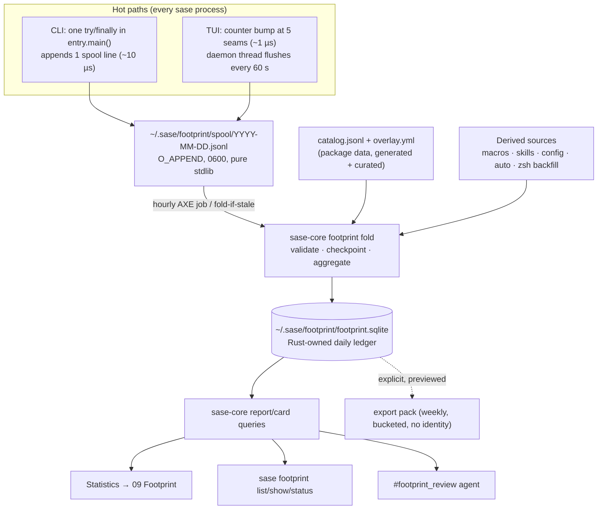

- **PROMPT:**
  [prompts/202610/footprint_usage_census.md](https://github.com/sase-org/sase--agents/blob/main/prompts/202610/footprint_usage_census.md)

# Plan: Footprint — a local usage census for finding what sase should delete

## Why and what

The user wants to find the parts of sase they never use, so that after a month or two of
monitored use they can delete them. There are three constraints. Footprint must not slow
sase down (the TUI is already too slow). It must never store sensitive data, because
external users may later opt in to uploading usage packs. And the review experience must
be intuitive, reliable, and beautiful.

This epic implements the design in the research report
`research:202610/footprint_feature_usage_tracking/footprint_feature_usage_tracking.md`.
Phase workers should read it with `sase artifact read` before starting. The user has
agreed with all of its requirement adjustments (R1–R12). This plan decides the open
questions the report left and fixes the contracts that every phase shares.

**The core idea is a census, not an event log.** An event log cannot show a zero, and
the goal is to find zeros. A **feature catalog** generated from sase's own registries is
the denominator. It is joined with **per-day aggregate counts**, split by **actor**
(you, agents, automation), **via** (key, palette, CLI, …), and **outcome**. "Never used"
then means "in the catalog, with no recorded use over a window that was actually
observed."

### Decisions this plan makes (the research left them open)

- **Name and home.** The feature is called Footprint. The command is a top-level
  `sase footprint` group, and the view is Admin Center → Statistics → `09 Footprint`.
  `usage` already means LLM quota windows and `telemetry` means health metrics. The
  existing `sase.core.disk_footprint_*` modules (`sase disk`) are unrelated. New code
  lives in `src/sase/footprint/` and sase-core's `footprint` domain. Neither may import
  disk-footprint code.
- **The on/off switch is a mode file, not YAML config.** The command is
  `sase footprint mode off|local`, following Go's `go telemetry off|local|on`. The hot
  path must not load YAML config, and turning recording off must take effect
  immediately. `share` is reserved for a future upload phase and is rejected today.
  Tunables (retention, thresholds) do live in a `footprint:` config section, which only
  the fold, report, and view code reads.
- **The catalog is a checked-in generated file.** It lives at
  `src/sase/footprint/catalog.jsonl` and is regenerated by `just fix` and checked by
  `just lint`, following `tools/sync_completion_spec`. PR diffs then show surface
  changes. The fold job needs no heavy imports, and installed TUIs ship their own
  catalog.
- **Keep reasons live in a repo overlay** (`src/sase/footprint/overlay.yml`), alongside
  protected classes and retire-together siblings. The installed TUI never writes repo
  files. Local decisions go into the ledger's `reviews` table, and the
  `#footprint_review` agent moves keep reasons into the overlay through a normal change.
- **Machines are merged by manual export/import.** This uses the same identity-free pack
  format a future server would receive. Import is replace-all, so re-imports never
  double count.
- **Candidate gate:** at least 60 days in the catalog and at least 30 observed active
  days on the relevant surface. A 3-day calibration window is excluded. All of these are
  configurable.
- **The Overview tile is dropped** from the research design. The `09 Footprint` tab
  already advertises the view. The one-time "review ready" notification makes the first
  review an event, without churning every Overview golden.
- **No beta feature flag.** The epic lands as a unit. `footprint.mode` is a permanent
  user choice, so it is not a flag (`sase_flags.md`).

## Architecture



On the hot paths, sase only appends a line or bumps a counter. No SQLite, Rust import,
YAML config load, or Textual timer is ever involved. Validation, aggregation, and the
catalog join all happen later in sase-core.

## Shared contracts

Every phase implements against these contracts. A phase that needs to change one must
update this section's equivalent in `docs/contribute/footprint.md` in the same change.

### Feature IDs

A feature ID has the form `<ns>:<path>` and must match `^[a-z]+:[a-z0-9_.~#-]+$`. There
are no spaces, no uppercase letters, and nothing user-authored.

| ns       | Example IDs                                                                                    | Source of truth                                                                                                                                                |
| -------- | ---------------------------------------------------------------------------------------------- | -------------------------------------------------------------------------------------------------------------------------------------------------------------- |
| `cli`    | `cli:bead.list`, `cli:_root`, option `cli:bead.list#json`                                      | Full argparse tree (`create_parser(only=None)`), with leaf paths joined by `.`; options use their `dest` names                                                 |
| `tui`    | `tui:app.zoom_panel`, `tui:fold.cycle_hooks`, `tui:statistics.cycle_range`                     | `build_command_catalog()` `CommandSpec.id` (prefixed `tui:`), plus every field of every `KeymapRegistry` scope and mode keymap dataclass                       |
| `view`   | `view:tab.agents`, `view:admin.statistics`, `view:stats.footprint`, `view:modal.plan_approval` | `TabName`, artifacts/files subtabs, `CenterTab`, `STATISTICS_VIEW_SPECS`, and `ModalScreen` subclasses (AST scan, snake_case, `Modal`/`Screen` suffix dropped) |
| `macro`  | `macro:research`, `macro:~custom`                                                              | Bundled macros in `src/sase/macros/*.md\|*.yml`                                                                                                                |
| `skill`  | `skill:sase_repo`                                                                              | Generated skill sources in `src/sase/macros/skills/`                                                                                                           |
| `config` | `config:ace.page_size`                                                                         | Leaf paths of `src/sase/default_config.yml`. Recorded as "override present", never the value                                                                   |
| `auto`   | `auto:axe.housekeeping.notification_store_compact`                                             | AXE routines and jobs declared in `default_config.yml`                                                                                                         |
| `plugin` | `plugin:listen`, `plugin:~third_party`                                                         | A constant tuple of first-party plugin command words                                                                                                           |

Rules:

- **Allowlist, never denylist.** An unrecognized value collapses to `<ns>:~other`.
  User-defined names (custom macros, custom modes, saved-query contents) become
  `~custom`. `tui:saved_query.<n>` slot numbers are fine.
- **Aliases share one ID.** The key binding and the palette entry for the same action
  are one feature reached two ways (`via`). The catalog dedups `tui:app.<action>` across
  `CommandSpec` and `AppKeymaps`.
- **Navigation chrome is neither counted nor catalogued.** Cursor movement, `j`/`k`,
  scroll, page, and focus-cycling actions are listed in one shared frozenset
  `NAVIGATION_ACTIONS` in `ids.py`. A catalogued action that is never recorded would
  look like a false candidate.
- The generator uses **bundled defaults only**. It never reads the user's config, keymap
  overrides, saved queries, or custom modes.

### Catalog file (`src/sase/footprint/catalog.jsonl`)

The first line is a header:
`{"schema":"sase.footprint.catalog/1","rev":"<12 hex>","count":N}`. Every following line
is one entry, sorted by `id`:

```json
{
  "id": "cli:bead.list",
  "ns": "cli",
  "area": "cli.bead",
  "kind": "command",
  "label": "List beads",
  "parent": null,
  "src": "sase/main/bead_handler.py:handle_list"
}
```

- `kind` is one of
  `command | option | action | mode_key | view | modal | macro | skill | config | auto | plugin`.
- `area` is the grouping used by the map:
  - `cli.<first word>`
  - `tui.<scope>` (for example `tui.app`, `tui.fold`, `tui.statistics`)
  - `views`, `modals`, `macros`, `skills`, `automation`, `plugins`
  - `config.<top-level key>`
- `label` is the existing help or description text.
- `parent` links an option to its command and a mode key to its mode.
- `src` is an optional `relative/module/path.py:qualname` for carrying-cost enrichment.
- `rev` is the first 12 hex characters of the sha256 of the canonical entry lines.

### Overlay (`src/sase/footprint/overlay.yml`)

This file holds curated human knowledge, reviewed in PRs:

```yaml
schema: sase.footprint.overlay/1
features: # exact id or trailing-* glob (each glob must match >= 1 catalog id)
  cli:doctor*:
    protected: recovery # safety | recovery | bootstrap | infra
    why: Repairs a broken install; runs rarely by design.
  cli:bead.list#json:
    keep: agent_facing # rare_by_design | safety | agent_facing | api_contract | other
    why: Skills parse this output.
retire_with: # siblings a cut should remove together
  - [cli:changespec.rebase, tui:app.rebase_changespec]
```

The catalog phase seeds `protected` entries for obvious rare-by-design surfaces: doctor,
init, update/upgrade, migrate, restore/recover, release, gate decisions, and uninstall.
Footprint's own surfaces are **never** protected, because the tool must pass its own
test.

### Paths and mode

`src/sase/footprint/paths.py` is stdlib only. It resolves the root exactly as
`sase.core.paths.sase_home()` does (`$SASE_HOME` or `~/.sase`), and a test asserts the
two agree. It provides:

- `footprint_dir()` → `<root>/footprint/` (directory mode 0700)
- `spool_dir()` → `<root>/footprint/spool/`
- `ledger_path()` → `<root>/footprint/footprint.sqlite`
- `mode_path()` → `<root>/footprint/mode`, containing `off` or `local`. A missing or
  unreadable file means `local`.
- `generation_path()` → `<root>/footprint/generation`, an integer that `clear` bumps

The effective mode is decided in this order:

1. `SASE_FOOTPRINT=off` → off. This is used by benchmarks, demos, and any user script.
2. Under pytest (`PYTEST_CURRENT_TEST` or `PYTEST_VERSION`) → off, unless
   `SASE_FOOTPRINT=test`. When it is `test`, writes go through
   `assert_test_state_write_isolated` (`src/sase/core/state_write_guard.py`).
3. Otherwise, the mode file.

### Actor, via, outcome

- **actor**, checked in this order:
  1. `agent` if any agent marker is present (`SASE_AGENT`, `SASE_AGENT_NAME`,
     `SASE_MONITOR_ID`, `SASE_GATE_COMMAND`). This must match
     `sase.agent.identity.agent_marker_present()` plus `SASE_GATE_COMMAND`, and a test
     pins the parity.
  2. `automation` if `SASE_JOB_ROUTINE`, `SASE_JOB_RUN_ID`, `SASE_SERVICE_UNIT`, or
     `SASE_PROC_ID` is set.
  3. `human` if `SASE_CLIENT` is a first-party client (`nvim`, `telegram`). Via then
     becomes `editor` or `chat`.
  4. `human` if stdin or stderr is a TTY.
  5. Otherwise `unknown`.

  A TTY never overrides a marker, because agents use PTYs.

- **via:**
  `key | mouse | palette | mode | cmdline | cli | completion | editor | chat | prompt | history | auto`.
- **outcome:** `ok | error | usage_error | help | cancelled`.

### Spool line schema v1

Each record is one line of at most 512 bytes, appended with a single
`os.write(fd, data)` on an `O_WRONLY|O_APPEND|O_CREAT` fd opened with mode 0600. Writers
need no lock. The writer builds lines with f-strings over validated tokens and never
imports `json`.

```json
{"s":1,"d":"2026-10-27","f":"cli:bead.list","a":"human","v":"cli","o":"ok","n":1,"ms":312,"opt":["json","status"],"ver":"0.18.1"}
{"s":1,"d":"2026-10-27","probe":"tui","ver":"0.18.1"}
{"s":1,"d":"2026-10-27","drop":17,"ver":"0.18.1"}
```

- `d` is the **local** calendar date at write time.
- `n` is 1 for the CLI. The TUI flush aggregates, so its lines carry `n` greater than or
  equal to 1.
- `ms` and `opt` appear on CLI lines only. `opt` holds at most 16 option `dest` names
  for the leaf in `f`. If more would not fit, the writer truncates `opt` rather than the
  line.
- `probe` marks a surface family as measured that day. The TUI flusher writes one per
  flush.
- `drop` reports records skipped because the day file hit the 32 MB cap. Drop lines are
  allowed up to the cap plus 1 MB.
- `ver` is `sase.__version__`.

### Ledger (sase-core, `~/.sase/footprint/footprint.sqlite`)

The ledger is Rust-owned. Python opens it only through bindings, and it must be
registered in the "SQLite Ownership" table and `tests/test_sqlite_single_owner.py`. It
uses WAL, `synchronous=NORMAL`, file mode 0600, directory mode 0700, separate read/write
openers, and bounded busy timeouts. Follow `tool_run/store/connection.rs`.

```sql
meta(key TEXT PRIMARY KEY, value TEXT NOT NULL)  -- schema_version, generation, first_record_day
catalog_revs(rev TEXT PRIMARY KEY, sase_version TEXT, entry_count INTEGER,
             first_seen_day TEXT, last_seen_day TEXT)
features(feature_id TEXT PRIMARY KEY, ns TEXT, area TEXT, kind TEXT, label TEXT,
         parent TEXT, src TEXT, loc INTEGER, first_in_catalog TEXT, last_in_catalog TEXT)
daily(day TEXT, feature_id TEXT, actor TEXT, via TEXT, outcome TEXT, origin TEXT,
      n INTEGER, dur_ms_sum INTEGER, dur_ms_max INTEGER,
      PRIMARY KEY (day, feature_id, actor, via, outcome, origin))
coverage(day TEXT, surface TEXT, origin TEXT, measured INTEGER, human_active INTEGER,
         records INTEGER, torn INTEGER, dropped INTEGER, unknown_ids INTEGER,
         incomplete INTEGER, PRIMARY KEY (day, surface, origin))
fold_checkpoints(file TEXT PRIMARY KEY, file_id TEXT, offset INTEGER,
                 complete INTEGER, folded_at TEXT)
-- queries phase adds: reviews(feature_id PRIMARY KEY, decision, reason, decided_day, snooze_until)
-- export_import phase adds: import_packs(nonce PRIMARY KEY, week, imported_day),
--   imported_weekly(nonce, week, feature_id, actor, days, n_bucket), imported_observed(nonce, week, surface, days)
```

- `origin` is a closed enum:
  - `live`
  - `derived.macros`, `derived.skills`, `derived.config`, `derived.auto`,
    `derived.history`

  There is **no** PID, host, path, project, or session column anywhere.

- `surface` families are `cli`, `tui` (which also covers `view`), `macro`, `skill`,
  `config`, `auto`, and `plugin` (measured by the CLI seam).
- A schema test asserts that the columns are exactly this allowlist. This guards against
  a later "helpful" join that adds an agent name or path.

### Privacy contract (closed capture)

The store accepts only catalog IDs, option `dest` names, enum values, local dates,
counts, durations, and the sase version. Rust enforces this independently at fold time.
Unknown keys and enum values make a line invalid (counted as torn). An unknown feature
ID becomes `<ns>:~other` and is counted in `unknown_ids`.

The store **never** records any of the following, and never records hashes of them:

- argument or option values
- prompts, queries, clipboard contents, or file contents
- paths or cwd
- repo, project, or branch names, or remotes
- artifact refs, or bead, agent, or session IDs
- usernames, hostnames, or IPs
- model aliases
- raw errors or environment values

Existing logs that do hold such fields (`skill_uses.jsonl`, launch archives) contribute
**counts by catalog ID only**. `~/.sase/installation_identity.json` is never read by
Footprint.

### Performance budgets (enforced by tests or benches)

| Path            | Budget                                                                                                              |
| --------------- | ------------------------------------------------------------------------------------------------------------------- |
| CLI hit         | ≤ 100 µs p99 added. No new imports beyond stdlib plus `sase.footprint._cli`/`_spool`/`_actor`/`_mode`/`paths`/`ids` |
| TUI action bump | ≤ 2 µs. Zero event-loop I/O. `j`/`k` p95 under 16 ms unchanged (`SASE_TUI_PERF=1`)                                  |
| TUI flush       | Daemon thread only. No Textual timer, no pump involvement                                                           |
| TUI startup     | Zero Footprint work before first paint. Index maps are built lazily on the first hit                                |
| View load       | ≤ 50 ms in a worker thread from the ledger. Fold-if-stale runs in the same worker, never on the loop                |
| Fold            | ≤ 1 s per day of spool. Never on a TUI or CLI hot path                                                              |

### Config (`footprint:` in `src/sase/default_config.yml`; the fold_status phase adds it)

```yaml
footprint:
  retention_days: 400
  spool_keep_days: 7 # delete fully folded spool files after this many days
  spool_max_age_days: 30 # delete any spool file older than this, marking coverage incomplete
  review:
    min_catalog_days: 60
    min_active_days: 30
    calibration_days: 3
    fading_days: 30
  review_project: sase # project where "Finish review" launches #footprint_review
```

Add the matching `sase.schema.json` entries and regenerate the config docs with
`just fix`.

### CLI surface (alphabetical; every long option has a short alias)

| Command                                                                                                                 | Phase           |
| ----------------------------------------------------------------------------------------------------------------------- | --------------- |
| `sase footprint backfill [-p/--path FILE] [-y/--yes]`                                                                   | derived_sources |
| `sase footprint catalog [-A/--area] [-f/--format] [-n/--namespace]`                                                     | catalog         |
| `sase footprint clear [-y/--yes]`                                                                                       | fold_status     |
| `sase footprint decide ID {keep,later,cut,clear} [-r/--reason {rare_by_design,safety,agent_facing,api_contract,other}]` | cli_report      |
| `sase footprint export [-o/--output FILE] [-p/--preview] [-w/--weeks N]`                                                | export_import   |
| `sase footprint import FILE... [-n/--dry-run]`                                                                          | export_import   |
| `sase footprint list [-a/--actor] [-A/--area] [-f/--format] [-l/--lens] [-r/--range]`                                   | cli_report      |
| `sase footprint mode [{off,local}]`                                                                                     | cli_recording   |
| `sase footprint show ID [-a/--actor] [-f/--format] [-r/--range]`                                                        | cli_report      |
| `sase footprint status [-f/--format]`                                                                                   | fold_status     |

- `--format` is `rich | json | markdown`, with `rich` as the default. Markdown is meant
  to be pasted into an agent prompt.
- `--actor` is `you | agents | automation | everyone`, with `you` as the default.
- `--lens` is
  `map | cold | fading | agent-only | dead-paths | friction | hot | coverage | decisions`.
- `--range` accepts `Nd`, `Nw`, or `all`, with `60d` as the default.
- A bare `sase footprint` delegates to `list`, through the central default-list
  mechanism.
- Follow `cli_rules.md`.

### Evidence states, the candidate gate, and lenses (computed in Rust)

Each feature is assigned exactly one evidence state:

```text
not_measured  — its surface family has no measured day in the window
too_new       — gate not met: < min_catalog_days in catalog, or < min_active_days observed
                active days on its surface (calibration days excluded for live surfaces)
used          — at least one record in the window for the lens's actor scope
rare_by_design— zero use and overlay-protected (shown with a lock-like glyph, never a candidate)
no_recorded_use (candidate) — zero use, gate met, unprotected
retired       — not present in the latest catalog revision
```

There is one extra flag, `coverage_incomplete`. It is set when the window holds
`dropped > 0` or `incomplete = 1` days for the feature's surface, and it adds an amber
qualifier. **An unknown is never drawn as a pale zero.** A decision (`keep`/`later`/
`cut`) is metadata on top of the state. A feature in `later` re-enters Cold after its
`snooze_until` date.

An **observed active day** for a surface is a day where `coverage.human_active = 1` (or
`measured = 1` for lenses scoped to agents, automation, or everyone). Days are unioned,
never summed. **The primary metric is days used out of observed active days.** Raw
counts are secondary.

| Lens         | Rows                                                                                                             | Sort                       |
| ------------ | ---------------------------------------------------------------------------------------------------------------- | -------------------------- |
| `map`        | One row per area: total, used, recency buckets (≤7d, ≤30d, in window, none, not measured), used %                | Grouped by ns, used % desc |
| `cold`       | Candidates: zero use by **anyone**, gate met, unprotected, undecided or snooze expired                           | `loc` desc, then id        |
| `fading`     | Used by the actor before the last `fading_days`, none since                                                      | last used asc              |
| `agent-only` | Agents > 0, human = 0                                                                                            | agent days desc            |
| `dead-paths` | (a) bound TUI features never reached via `key` but used another way; (b) zero-use options whose command was used | parent days desc           |
| `friction`   | `(usage_error + help) / total ≥ 0.25` and `total ≥ 3`                                                            | ratio desc                 |
| `hot`        | Top 50 by days used, with `dur_ms_sum` (CLI time spent)                                                          | days desc, n desc          |
| `coverage`   | One row per surface family: measured days, active days, torn/dropped/unknown, first measured day                 | fixed order                |
| `decisions`  | All local review decisions with their current evidence                                                           | decided day desc           |

The report also returns:

- **Tiles:** used/total, candidates (flagged `preview` until the global gate is met),
  rare by design, agent-only, and not measured.
- **Header:** actor, window, observed active days per surface, recording-since date,
  gate progress (`active_days`/`required`), generation, and imported pack count.

## Phase details

### catalog

The goal is to make a complete, deterministic denominator before anything is recorded.

1. Create `src/sase/footprint/__init__.py` with a docstring only. It must stay
   import-free, because hot paths import submodules.
2. Write `ids.py` (stdlib only): the namespaces, ID regex, sentinels,
   `NAVIGATION_ACTIONS`, `FIRST_PARTY_PLUGIN_COMMANDS`, and pure helpers
   (`cli_id(words)`, `cli_option_id(cmd_id, dest)`, `tui_id(scope, action)`,
   `view_id(...)`, `modal_id(class_name)`). Write `paths.py` as specified above. The
   recorder and the generator both use these helpers, so IDs cannot drift between them.
3. Write `catalog_gen.py`. Hot paths never import it. It walks:
   - the full parser tree, reusing the walk style of `src/sase/completion/build.py` or
     `tests/main/parser_help_helpers.py`. It covers commands and option dests, deduping
     alias-shared parsers by `id()`.
   - `build_command_catalog(load_keymap_registry(<bundled ace cfg>))`, keeping only
     built-in IDs
   - every `KeymapRegistry` dataclass scope and every mode keymap class, enumerated
     dynamically so a new scope is picked up automatically
   - `TabName`, the artifacts/files subtabs, `CenterTab`, and `STATISTICS_VIEW_SPECS`
   - an **AST scan** for transitive `ModalScreen`/`Screen` subclasses under
     `src/sase/ace/tui/`
   - bundled macros and generated skill sources
   - `default_config.yml` leaf paths. Lists count as one leaf, and the `footprint:`
     section is excluded.
   - AXE routine and job names
   - first-party plugin words

   It fills `label`, `parent`, and `src` where they are cheaply known: the handler
   function for a CLI leaf, `AceApp.action_<name>` for TUI actions, and the module path
   for macros and skills.

4. Write the light loader `catalog.py`: `catalog_path()` via `importlib.resources`,
   `load_catalog()`, and `load_overlay()`. Write the seed `overlay.yml`.
5. Add `tools/sync_footprint_catalog --write|--check`, modelled on
   `tools/sync_completion_spec`. Add a Justfile `sync-footprint-catalog` recipe. Wire
   `--write` into `just fix` and `--check` into `just lint`, either next to the
   `docs-gen`/`docs-gen-check` pair or through `tools/render_docs --sase-only` if that
   is the established registry. **This is the drift guard**: a PR that adds a parser
   leaf, option, binding, macro, skill, view, modal, or config leaf fails lint until
   regenerated. Confirm that `toobig` ignores the `.jsonl` file.
6. Add the `sase footprint` group and the `catalog` subcommand:
   - `parser_footprint.py`
   - a registrar entry in `parser_registry.py` and the full registrars
   - a dispatch branch in `entry.py`
   - `footprint_handler.py`

   The rich output groups by area with counts. The group help explains Footprint in 2–3
   lines.

7. Tests in `tests/footprint/`:
   - **Completeness:** every parser leaf and option, every `CommandSpec`, every keymap
     scope field, every mode field, every view and modal, every macro and skill, and
     every config leaf has an ID.
   - All IDs are valid and unique.
   - There are no user-config-derived IDs. Load with a user config containing a custom
     mode and a saved query, and assert the catalog is unchanged.
   - Every overlay key or glob matches at least one ID.
   - The generator is deterministic across two runs.
8. Start `docs/contribute/footprint.md` with "Feature IDs and the catalog": how IDs are
   formed, how to regenerate, what the overlay is for, and the allowlist rule.

### ledger

This phase works in sase-core: open it with `sase repo open sase-core` and follow its
`AGENTS.md` binding recipe. It is two coordinated commits, sase-core plus the sase
adapter.

1. Add `crates/sase_core/src/footprint/` with:
   - `wire.rs`: all `*Wire` types and `FOOTPRINT_WIRE_SCHEMA_VERSION = 1`
   - `spool.rs`: line parsing and validation per the v1 schema
   - `catalog.rs`: catalog JSONL parsing and the rev check, plus shape validation of the
     overlay that Python's `load_overlay()` parses from YAML and passes as a dict
   - `store/`: schema, openers, migrations, mode bits
   - `fold.rs`
   - `status.rs`
   - `derived.rs`
   - `maintenance.rs`: prune and clear
2. Implement the fold. For each `spool/*.jsonl`, sorted:
   - stat the file (`dev:ino` gives `file_id`)
   - `BEGIN IMMEDIATE`, read the checkpoint, and reset the offset to 0 if `file_id`
     changed
   - consume bytes from the offset up to the last `\n` only, leaving a trailing partial
     line for the next fold
   - validate and aggregate in memory, expanding `opt` into `<f>#<dest>` rows
   - upsert `daily` and `coverage`
   - advance the checkpoint **in the same transaction**, and `COMMIT`

   A file is `complete` when its day is before `today` and the offset equals its size.
   After the loop:
   - delete complete files older than `spool_keep_days`
   - delete any file older than `spool_max_age_days` and set `coverage.incomplete = 1`
     for that day

   Concurrent folds must be safe, because the AXE job and an on-demand fold can overlap.
   The checkpoint is read inside the write transaction.

3. Implement the APIs. Python passes all paths and `today` (the local date) explicitly:
   - `footprint_catalog_status(store_path, catalog_path) -> {rev, known}`
   - `footprint_ingest_catalog(store_path, catalog_path, enrichment: {id: loc}, today)`:
     upserts `features`, keeps `first_in_catalog` at its earliest value, and sets
     `last_in_catalog` for present IDs
   - `footprint_fold(store_path, spool_dir, today, spool_keep_days, spool_max_age_days) -> FoldResultWire`
   - `footprint_upsert_derived(store_path, origin, days: [..], rows: [...], coverage: [...])`:
     replaces exactly that origin's rows for those days, so it is idempotent
   - `footprint_status(store_path, spool_dir, today) -> StatusWire`: schema, generation,
     first record day, last fold time, spool files and bytes pending, ledger bytes,
     catalog rev and count, the last 7 days of coverage per surface, and fault totals
   - `footprint_prune(store_path, today, retention_days)`
   - `footprint_clear(store_path, spool_dir) -> {generation}`: deletes data rows and
     spool files, and bumps `meta.generation`
4. Add `crates/sase_core_py/src/footprint/{mod.rs,tests.rs}` and `register_footprint`.
   Every pyfunction runs inside `py.allow_threads`.
5. On the sase side:
   - add `src/sase/core/footprint_facade.py` (via `require_rust_binding`)
   - register the store in the SQLite Ownership table in
     `docs/contribute/rust-backend.md` and in `tests/test_sqlite_single_owner.py`
   - mirror the schema-version constant where `tools/validate_sase_core_rs` expects it
   - add binding smoke tests in `tests/footprint/test_binding_smoke.py`
   - move `sase-core-revision.txt` (`just ratchet-core-revision`)
6. Rust tests:
   - torn and partial lines
   - double fold equals single fold
   - crash between read and commit, simulated by dropping the transaction, double counts
     nothing
   - rotated or replaced file
   - unknown IDs becoming `~other`
   - invalid enums
   - the 32 MB drop lines
   - derived upsert idempotency
   - prune and clear
   - the column-allowlist schema test
   - concurrent folds from two threads
7. Run `sase tool run check` in sase-core and `just check` in sase.

### cli_recording

1. Add stdlib-only modules:
   - `src/sase/footprint/_spool.py`: `append_lines(lines)` in one `os.write`. On a
     missing directory it runs `os.makedirs(mode=0o700)` and retries once. It enforces
     the 32 MB cap with drop lines, and it swallows every `OSError`.
   - `_actor.py`
   - `_mode.py`
   - `_cli.py`: `CliHit` with `begin()`, `set_path(words)`, `set_options(dests)`,
     `mark_parse_stage()`, and `record(exit_code | exc)`
2. Wire `entry.py:main()`. Move the current body into `_main()`, and have `main()` call
   `hit = begin()` and then `try: _main()` with outcome capture and
   `finally: hit.record()`. `record()` never raises and never changes the exit code.
   Outcomes:
   - `SystemExit` with code 0 during `parse_args` → `help`
   - code 2 during parse → `usage_error`
   - `KeyboardInterrupt` → `cancelled`
   - another non-zero exit → `error`
3. Feature paths:
   - **Successful parse:** a parser post-pass sets `set_defaults(_footprint_cmd=...)` on
     every leaf. Add it beside `default_list_subcommands()` in
     `parser_root_defaults.py`.
   - **Help or usage error:** walk argv words through the already-built parser to the
     deepest matched group.
   - **Fast paths:** bead, goal, completion candidates/ensure, `run` special cases, and
     plugin dispatch each call `set_path` before they exit. Completion records
     `cli:completion.candidates` and never the prefix being completed. Plugins record
     `plugin:<word>` or `plugin:~third_party`.
   - **Options:** map `-`-prefixed argv tokens through the leaf parser's
     `_option_string_actions` to `dest`. `--x=y` is split before lookup. Values are
     never read. Fast paths record the command only.
4. `sase ace`/`sase tui` exit through `os._exit` in `_hard_exit_ace`, and restart uses
   `os.execv`. Record explicitly before both.
5. Add `sase footprint mode [{off,local}]`. With no argument it prints the mode and a
   one-line disclosure. Setting a mode writes the mode file atomically.
6. Tests:
   - actor precedence and parity with `agent_marker_present()`
   - mode precedence, including pytest off-by-default
   - spool line format and the 512-byte limit
   - subprocess tests with a sandboxed `SASE_HOME` and `SASE_FOOTPRINT=test` covering a
     normal command, `-h`, a usage error, a fast path (`bead`, `completion candidates`),
     and the `run` special case
   - an import-closure test showing the recorder adds only the listed modules
   - a `slow`-marked bench asserting ≤ 100 µs p99 added
7. Add a reference page `docs/reference/footprint.md` with "What Footprint records",
   "What it never records", and "Turning it off". This disclosure must exist the moment
   recording does. Add `SASE_FOOTPRINT` and `SASE_CLIENT` to
   `docs/reference/environment-variables.md`. Check whether any demo tape or benchmark
   runs against a real home, and set `SASE_FOOTPRINT=off` there (read `demos.md` first).

### tui_recording

1. Add `src/sase/footprint/_tui.py`:
   - `TuiCounter`: `dict[(feature_id, via), int]`, with one actor classified once at
     first hit.
   - `bump()` is the only call on the event loop.
   - The daemon thread `sase-footprint-flusher` starts lazily on the first hit. Every 60
     s, if dirty, it swaps the dict, writes aggregated lines plus one `probe: tui` line
     via `_spool`, and re-reads the mode and generation files. If the mode is `off`, or
     the generation changed since the counts began, it discards them.
   - `flush_now(timeout=0.2)` is used at exit.
   - Follow the shape of `src/sase/telemetry/_registry.py` (`_start_flusher`, `drain`,
     after-fork reset).
2. Add the seams in one new mixin, so every hit goes through the same counter:
   - **`AceApp.run_action` override:** count only when `super()` returns True. Key the
     count by the scope of `default_namespace` plus the action name with parameters
     stripped. Use a lazily built and cached class→scope map, and skip
     `NAVIGATION_ACTIONS`. `via` is `mouse` if `on_mouse_down` set a one-shot flag,
     otherwise `key`.
   - **`commands/execute.py:execute_command`:** one hit for `tui:<spec.id>` with
     `via=palette`.
   - **`actions/_event_keyboard.py:on_key`:** when a `_handle_<mode>_key` returns True,
     record `tui:<mode>.<field>` with `via=mode`. Use a reverse key→field map per mode,
     rebuilt when the keymap registry object changes. Custom modes record
     `tui:custom.~custom`.
   - **View entry:**
     - `watch_current_tab` → `view:tab.<name>`, only after startup completes and never
       for the restored initial tab
     - artifacts/files subtab watchers
     - `_on_admin_center_tab_activated` → `view:admin.<tab>`
     - Statistics `_set_view` → `view:stats.<view>`
     - an `AceApp.push_screen` override → `view:modal.<snake>`
3. Add the final flush in `actions/lifecycle.py:on_unmount` and in the `_hard_exit_ace`
   flush tuple.
4. Tests:
   - **Textual contract test:** a pilot dispatches one binding per keymap scope, one
     palette command, one mode key, one tab switch, and one modal, and asserts exactly
     one hit each. It must pass on the workspace-pinned Textual. Note in the bead if the
     installed version differs.
   - the restored startup tab is not counted
   - `bump()` does no I/O (monkeypatch `os.write` and assert the calling thread is not
     the loop thread)
   - a microbench of `bump()` ≤ 2 µs
   - mode off discards counts
   - the generation bump discards counts
5. Measure `j`/`k` p95 with `SASE_TUI_PERF=1` (`tests/ace/tui/bench_tui_jk.py`, via
   `/sase_monitor` if long) before and after. Record both numbers in the phase bead
   notes. A regression of more than 0.5 ms p95 blocks the phase.
6. Append "Recording seams" and "Performance budgets" to `docs/contribute/footprint.md`.

### fold_status

1. Add `src/sase/footprint/fold.py`, the driver:
   - Get the catalog status. If the rev is unknown, compute carrying-cost enrichment and
     ingest.
   - `fold_ledger()` runs the fold and prune.
   - `fold_if_stale(max_age=600s)` folds when the last fold is older than `max_age` and
     the spool has pending bytes. Both checks are cheap stats.
   - It uses short busy timeouts. On lock contention it skips the fold and reads the
     ledger as is.
2. Add `src/sase/footprint/carrying_cost.py`: handler LOC per catalog `src` via AST,
   with one parse per file. The result is cached per catalog rev inside the ingest
   (`features.loc`).
3. Add an AXE housekeeping job `footprint_fold` (hourly lane in
   `axe.routines.housekeeping.jobs`). Its script is `sase_job_footprint_fold`, a
   `pyproject.toml` entry point built with `@builtin_chop` and `run_builtin_chop`,
   modelled on `src/sase/scripts/sase_chop_notification_store_compact.py`. The job
   folds, prunes, and emits a summary.
4. Add the `footprint:` config section (see Shared contracts) with schema and docs.
5. `sase footprint status` runs `fold_if_stale` first. The rich output is a calm panel:
   - Mode
   - Privacy ("feature IDs and counts only · stays on this machine")
   - Recording since
   - Ledger (path and size, display only)
   - Last fold age and spool backlog
   - Catalog (surfaces and rev)
   - Coverage: the last 7 days per surface, as one glyph per day
   - Faults: dropped, torn, and unknown IDs. Red is used only for nonzero faults.

   JSON output is the wire.

6. `sase footprint clear [-y]` confirms, then clears and writes the new generation file.
7. On the first fold that ingests records, upsert one inbox notification with dedup key
   `footprint.disclosure` (`notifications/store.py:upsert_notification`): "Footprint is
   recording local usage counts (feature IDs only; nothing leaves this machine). Review
   it in Admin Center → Statistics → Footprint · turn off with
   `sase footprint mode off`."
8. Add a doctor check that warns when the mode is `local` and unfolded spool is older
   than 3 days.
9. Tests:
   - fold-if-stale gating
   - LOC enrichment on fixture modules
   - the job entry point
   - status rendering in rich and JSON
   - clear with confirmation
   - disclosure dedup
   - the doctor check
10. Update `docs/reference/footprint.md` (status, clear, the hourly fold) and
    `docs/reference/automation/scheduler-housekeeping.md`.

### queries

This phase also works in sase-core, as two commits.

1. Add `crates/sase_core/src/footprint/query/` (report, card, lenses, gate, evidence),
   and add `reviews` to the schema through an additive migration on write.
2. Add `footprint_report(request) -> ReportWire`. The request carries `store_path`, the
   parsed overlay, `today`, `window_days | all`, `actor`, `lens`, an optional `area`,
   the `gate` thresholds, `calibration_days`, `fading_days`, and `limit`. The response
   has the header, tiles, areas, and rows described in Shared contracts. Each row
   carries:
   - id, label, area, kind, state, `coverage_incomplete`
   - uses per actor, days used, last used day and actor
   - via and outcome breakdowns, `dur_ms_sum`, `loc`
   - protected class, decision
3. Add `footprint_card(request) -> CardWire`. It returns the row fields plus:
   - `daily_series` for the window, as `[{day, n, measured}]`
   - `first_in_catalog`, `last_in_catalog`
   - `parent`, `children` (options of a command, keys of a mode)
   - `retire_with` siblings
   - the area summary used by the map card: totals, buckets, and the 5 largest unused
     surfaces by LOC
4. Add `footprint_decide(store_path, feature_id, decision, reason, today, snooze_days)`.
   `clear` deletes the row, and `later` sets `snooze_until = today + snooze_days`.
5. Add bindings, facade functions, and the pin move as in the ledger phase.
6. Rust tests: each lens on a hand-built fixture ledger, including:
   - the gate boundary (59 versus 60 days, 29 versus 30 active days)
   - calibration exclusion
   - protected globs
   - snooze expiry
   - `not_measured` versus `no_recorded_use`
   - `coverage_incomplete`
   - aliases reached by palette only (dead paths)
   - unioned days across actors

### derived_sources

Each source computes `(day, feature_id, actor, via, outcome, n)` rows and coverage, and
calls `footprint_upsert_derived` for its own origin. Sources are recomputed idempotently
from the hourly job, and they never copy rows from the logs they read.

- **Macros (`derived.macros`, `via=prompt`).** Read launch-prompt macro data through the
  existing Rust aggregation behind `src/sase/stats/query.py:query_run_stats`. Extend it
  in sase-core if per-day and per-launcher granularity is missing; that is two commits
  plus a pin move. This backfills full history on day one. The actor is `agent` when the
  launch had a parent agent, otherwise `human`. Non-bundled names become
  `macro:~custom`.
- **Skills (`derived.skills`, `actor=agent`).** Count `skill_uses.jsonl` records by
  `skill_name` and day across projects. Use only those two fields.
- **Config (`derived.config`, `via=config`).** Take a daily snapshot of which bundled
  leaf paths the user's config overrides. Paths only, never values. Unknown user keys
  become `config:~custom`.
- **Automation (`derived.auto`, `via=auto`).** Map existing telemetry series (AXE cycle
  and job executions) to `auto:` IDs through the Rust telemetry query bindings. Where a
  job cannot be tied to an ID, leave its surface **not measured**. Never guess.

> [!decision] shell_history_backfill

- **zsh backfill (`derived.history`, `via=cli`, `actor=human`).** Add
  `sase footprint backfill [-p FILE] [-y]`:
  - It reads `$HISTFILE` or `~/.zsh_history`.
  - It keeps only extended-history lines (`: <epoch>:<dur>;cmd`) whose command starts
    with `sase `.
  - It resolves argv through the full parser to command and option IDs exactly as the
    CLI recorder does, and discards everything else. Lines are never stored.
  - It prints a preview count per command and asks for confirmation.
  - Re-running it replaces the `derived.history` origin.
  - Lines without timestamps are skipped and counted.

  Document that it is local-only, never automatic, and that the file it reads contains
  everything else you type.

Wire the macros, skills, config, and automation sources into the hourly job after the
fold. Each source failure is logged and leaves that origin's previous rows intact. Test
each extractor on fixtures and assert that no forbidden field reaches a row.

### cli_report

1. Add the shared render layer in `src/sase/footprint/render/`. It returns Rich
   renderables and per-row `Text` that both the CLI and the TUI use, and reuses
   `src/sase/stats/render/primitives.py`,
   `src/sase/telemetry/render/{sparkline,tiles}.py`, and `RenderContext` widths. It
   covers:
   - `header`: the trust line and chip
   - `tiles`
   - `area_row`: label, a **proportional heat strip** sorted hot→cold and scaled to
     width, `used/total`, `%`, and a `◂` cold marker below 25%
   - `feature_row`: state glyph, label with muted id, per-actor uses, days used, last
     used, via mix, LOC, decision badge
   - `card`
   - `evidence_sentence(card)`: plain language that always states its denominator, for
     example "No recorded use by you across 41 observed active days."
   - `legend`
2. Visual language. Consistency is the beauty here:
   - The Statistics accent `#FF87D7` ramp means **recency, and only recency**:
     - ≤7d is `█` in the accent
     - ≤30d is `▓` in a dimmer tint
     - in window is `▒` in a muted tint
   - `·` in neutral grey means no recorded use. **A zero is neutral, never red.**
   - `?` means not measured. It always carries a text label and never reads as a pale
     zero.
   - Amber means preview or incomplete evidence. Red is reserved for collector faults.
   - There is no emoji and no animation, and every state has a text label.
3. Add `sase footprint list`, `show`, and `decide` (see the CLI surface table).
   - `list` and `show` run `fold_if_stale` first.
   - Markdown output is compact and agent-ready: one table per lens, the evidence
     sentence, and IDs in backticks.
   - JSON output is the wire.
   - Adding `list` makes bare `sase footprint` delegate to it, so update the group help.
4. Tests:
   - each lens in all three formats, against a fixture ledger built through the facade
   - width scaling of heat strips
   - evidence sentences for every state
   - `decide` round-trips
5. Update `docs/reference/footprint.md` with "Reading the report": lenses, evidence
   states, the candidate gate, and actors.

### tui_view

1. Register view `footprint` as `09 Footprint` in `src/sase/stats/registry.py` (compact
   "Footprint", micro "Fp"). Its `groupings` are the nine lenses, so the existing `g`
   (`cycle_group`) cycles them. Its `legends` define days used, observed active day,
   candidate, rare by design, and not measured.
2. Update every place that assumes 8 views, using the map in the research survey:
   - `_result_paints_view`, `_current_view_is_empty`, `_empty_state_message`
   - the `show_tiles` sets and hints
   - `_result_matches_selection` and `_selection_identity`
   - the "Eight…" docstring
   - `_freshness_text`
   - the tab-strip compact/micro thresholds in `statistics_pane_layout.py`, retuned for
     9 tabs
   - the 8-view tests (`tests/stats/test_registry.py`,
     `test_statistics_scope_header.py`, `test_statistics_view_number_select.py`,
     `test_statistics_help_modal.py`, `test_statistics_pane_view_navigation.py`)
3. Add a loader branch. The worker thread runs `fold_if_stale` and then
   `footprint_report`, under the existing `run_worker(thread=True)` and generation
   guard. Show cached data first and keep the selection by feature ID across refreshes.
4. While view 09 is active, a body widget `FootprintBody` replaces the shared renderable
   body. It is an `OptionList` of `area_row` or `feature_row` options with section
   separators (CLI · TUI · Views · Prompts · Config · Automation · Plugins), and j/k and
   arrow navigation. Follow `feature_flags_pane.py` for list focus behaviour.
   - In the Map lens, `enter` drills into an area: all of its features, with a
     breadcrumb `Map › cli · changespec`.
   - `escape` or `backspace` returns, restoring the highlighted area.
5. The header is the existing scope-header row:
   `FOOTPRINT · you · last 60d · 41 of 60 days active · recording since Aug 28`, plus a
   right-aligned chip, either `PREVIEW 12/30 active days` (amber) or `READY` (accent).
   Tiles use the five slots: Used, Candidates, Rare by design, Agent-only, Not measured.
   Clicking a tile switches lens (Used→Map, Candidates→Cold, Agent-only→Agent-only, Not
   measured→Coverage).
6. Actor and range:
   - Add `cycle_actor: a` and `cycle_actor_reverse: A` to `StatisticsPaneKeymaps`,
     `_STATISTICS_BINDING_META`, `default_config.yml` (gotchas memory), and the schema.
     Regenerate the docs.
   - Footprint keeps its **own** range state, with presets
     `30d · 60d · 90d · 180d · all` and a default of 60d, cycled by the existing
     `t`/`T`. The census needs weeks, not the shared 7d default.
7. States, each with honest copy:
   - **Mode off:** "Footprint is off · `sase footprint mode local` to start"
   - **No ledger yet:** "Recording since 14:02 · first fold within the hour"
   - **Preview:** amber chip, candidates badged "preview"
   - **All unknown:** `?` rows plus a pointer to the Coverage lens
   - **Fold contention:** stale data shown with an age note
8. Mockup (wide):

```text
 Statistics  01 Overview 02 Runners 03 Projects 04 Providers 05 Activity 06 Macros 07 Plans/Q 08 Perf ▸09 Footprint
 FOOTPRINT · you · last 60d · 41 of 60 days active · recording since Aug 28           PREVIEW 12/30 active days
 ╭ Used ─────────╮╭ Candidates ───╮╭ Rare by design ╮╭ Agent-only ───╮╭ Not measured ─╮
 │ 412 / 1,180   ││ 214 preview   ││ 38             ││ 57            ││ 96            │
 ╰───────────────╯╰───────────────╯╰────────────────╯╰───────────────╯╰───────────────╯
 Lens ▸Map · Cold · Fading · Agent-only · Dead paths · Friction · Hot · Coverage · Decisions
 ── CLI ──────────────────────────────────────────────────────────────────────────────────
 ▸ bead          ███████████████▓▓▓▓▓▓▒▒▒▒▒·········              38/47   81%
   changespec    █▒▒··················                             3/21   14%  ◂
 ── TUI ──────────────────────────────────────────────────────────────────────────────────
   app           ████████████████████▓▓▓▓▓▓▓▒▒▒▒▒▒▒▒······       171/191  90%
   copy mode     ████▓▓▒▒▒·······································     9/78   12%  ◂
 ── Prompts ──────────────────────────────────────────────────────────────────────────────
   skills        ??????????????????                                —/20   not measured
 █ ≤7d ▓ ≤30d ▒ ≤60d · no recorded use ? not measured     ↵ open · g lens · a actor · t range · ? help
```

9. Tests:
   - loader branch and stale-generation discard
   - lens cycling, actor/range cycling, drill and back
   - every empty state
   - selection preserved across refresh
   - keymap coverage (`tests/test_keymaps_defaults_panels.py`)

   PNG goldens: Footprint Map and Cold at 120x40 and 90x30, preview, and empty. Every
   other `config_center_statistics_*` golden changes because of the tab strip. Inspect
   them per `lint_and_test.md` (`just fix-tui-screenshots`, via `/sase_monitor`).

### tui_card

1. Add the evidence card panel, debounced with `DetailPanelDebouncer`. The highlight
   paints immediately (tui_perf rule 7). The card fetch (`footprint_card`) runs in a
   worker with a generation check.
   - At width ≥ 120 the list and card sit side by side. Narrower, the card stacks below,
     and secondary row columns hide first.
   - In the Map lens the card shows the area summary.

```text
 cli:changespec.rebase                              changespec · CLI command
 ───────────────────────────────────────────────────────────────────────────
 Evidence     No recorded use by you across 41 observed active days.
              Measured the whole window · no known gaps · in catalog since Aug 28
 Uses (60d)   you 0 · agents 3 · automation 0           last: 41 days ago (agents)
 Activity     ▁▁▁▁▁▁▁▁▂▁▁▁▁▁▁▁▁▁▁▁▁▁▁▁▁▁▁▁▁▁▁▁▁▁▁▁▁▁▁▁▁▁▁▁▁▁▁▁▁▁▁▁▁▁▁▁▁▁▁▁
 Reached via  cli 3 · help 1 · usage error 1
 Carries      sase/main/changespec_handler.py:handle_rebase · 812 LOC
 Siblings     tui:app.rebase_changespec
 Decision     ○ undecided                                     d decide · y copy id
```

Unmeasured days in the activity sparkline render as a dim gap glyph, not as `▁`. 2. Add
`find_feature: slash`. It opens a filterable picker modal over all catalog features
(label and id), modelled on `StatisticsMacroPickerModal`. Choosing a feature switches to
an "All · <area>" drill with that feature highlighted. Add `copy_feature_id: y`. 3.
Tests and goldens: the card in each evidence state, wide and narrow layouts, the area
card, the picker filter, and copy.

### review_loop

1. Add `decide: d`. It opens a compact `FootprintDecideModal` showing the feature label
   and evidence sentence, with single-key choices:
   - KEEP: `r` rare by design · `s` safety · `a` agent-facing · `c` API contract · `o`
     other
   - LATER: `l` snooze 30 days
   - CUT: `x` mark for removal
   - `u` clear decision

   `footprint_decide` runs off-loop. The row badge updates optimistically, and the row
   leaves Cold.

2. Add `finish_review: F`. It opens a confirm modal: "Launch #footprint_review for 17
   cut · 6 keep decisions in project `sase`?"
   - `enter` launches through the existing durable launch path (`_submit_launch_proc`,
     prompt `#footprint_review`, project `footprint.review_project`).
   - `y` copies the prompt instead.
   - If the project is not registered, the modal falls back to copying, with a toast.
   - Footprint never deletes code, closes beads, creates flags, or opens PRs.
3. Add the bundled macro `src/sase/macros/footprint_review.md` (frontmatter `name`,
   `description`; read `macros.md` first). It instructs the agent to:
   - run `sase footprint list -l decisions -f markdown` and `sase footprint show <id>`
   - for each **cut**, do the archaeology: call sites, tests, docs, skill and memory
     mentions, and `git log`. Then file one task bead per cut, or a parent plus children
     for `retire_with` sets, via `/sase_new_task`. Note where the `sunset` flag policy
     applies.
   - for each **keep**, add or refresh the reason in `src/sase/footprint/overlay.yml` as
     a normal reviewed change
   - skip decisions already reflected in the overlay or in an existing bead, which makes
     re-runs idempotent
   - never delete code itself
4. Add the review-ready notification. After its fold, the hourly job checks the global
   candidate gate. The first time it is met and candidates exist, it upserts dedup key
   `footprint.review_ready.1`: "Your first Footprint review is ready: 23 candidates ·
   Admin Center → Statistics → Footprint."
5. Tests:
   - picker keys map to decisions
   - optimistic update and rollback on failure
   - the finish modal launches or copies, including the fallback path
   - the macro renders, and its body references only real commands
   - notification dedup

   Goldens: the decide modal and the finish modal.

### export_import

1. sase-core work: add `footprint_export(request) -> [PackWire]`, one pack per complete
   ISO week. Each pack has:
   - `schema: "sase.footprint.export/1"`
   - a random `nonce`
   - `week`
   - `sase` (major.minor only)
   - `os` (`linux` or `darwin`)
   - `observed` days per surface
   - `features`: `[{id, actor, days, n}]` for nonzero rows only, with `n` bucketed as
     `1 | 2-5 | 6-20 | 21+`
   - `not_measured` surfaces

   Built-in IDs only: no `~custom`, no config leaves, no option IDs, and no plugin
   names. It never includes reviews, durations, or imported data. Add
   `footprint_import(store_path, packs, today)` as **replace-all**: it deletes the
   previous imported tables and loads these packs, deduping by nonce. Queries union
   imported weekly data into the map, cold, fading, agent-only, and hot lenses:
   - **Usage days** per week merge as `min(7, local + Σ imported)`. This is an upper
     bound, so it errs toward keeping.
   - **Observed days** merge as `max(local, imported)`. This is a lower bound, so the
     gate is conservative.
   - Dead paths, friction, and coverage stay local.

2. Add `sase footprint export [-o FILE] [-p] [-w N]`. The file is JSON Lines with one
   pack per line. `--preview` prints exactly the bytes that would be written. Add
   `sase footprint import FILE... [-n]`. The header and card say "+2 imported packs"
   with the import date.
3. Add a "Merging machines" section to `docs/reference/footprint.md`, and an "Export
   governance" section to `docs/contribute/footprint.md`: any change to exported fields
   requires a new decision record, and the server can never enable fields or modes.
4. Tests: bucket boundaries, exclusion of every forbidden category, byte-identical
   preview and file, idempotent re-import, the merge bounds, the pin move, and binding
   smoke.

### closeout

1. Reconcile `docs/reference/footprint.md` and `docs/contribute/footprint.md` into
   coherent pages within budget. Add both to the docs nav if they are missing. Update
   `docs/reference/tui/admin-center.md` (view 09). Point the intro of
   `docs/contribute/telemetry.md` at Footprint for product-usage questions, and note the
   separate store.
2. Run an end-to-end smoke in a sandboxed `SASE_HOME` with `SASE_FOOTPRINT=test`:
   - several CLI commands, including help, a usage error, and an agent-marked run
   - a TUI pilot session with a key, a palette command, and a modal
   - `fold`, `status`, `list -l map/cold/agent-only -f markdown`, `decide`,
     `list -l decisions -f markdown`, `export --preview`, and `import`

   Assert the expected IDs and the absence of any forbidden token (paths, the agent
   name, argv values). Keep it as a test where it is fast enough, otherwise as a smoke
   script.

> [!decision] memory_census_decision

3. If accepted, use `/sase_memory_write` to add the `decisions:footprint-census` strand
   ("Footprint Is An Allowlisted Census"). Claim: per-day aggregate counts of
   allowlisted catalog IDs and enums, never an event log or values. The store is
   separate from health telemetry. Export packs carry no stable identity, and changing
   exported fields requires a new record. Why: an event log cannot show zeros, and a
   persistent ID turns weekly packs into a profile. Cost: no unique-user counts, coarse
   merges. Reopens when: a concrete analysis need cannot be met by counts. Then run
   `sase memory init`.

> [!decision] memory_glossary_footprint

4. If accepted, add the `glossary:footprint` strand, defining Footprint (with feature
   ID, catalog, and observed active day inside the definition). Link
   `[[glossary:usage-window]]` to disambiguate, then run `sase memory init`.
5. Record `PROPOSED FOLLOW-UP:` notes on this phase bead for:
   - setting `SASE_CLIENT` in sase-nvim and sase-telegram
   - the `sys.monitoring` dark-code lens
   - the offline HTML atlas
   - a sase-listen monthly digest
   - `share` mode and the `sase.sh` endpoint, only once outside users exist
   - the go/no-go review of Footprint's own `view:stats.footprint` usage after the first
     review cycle

## Non-goals

These are deferred on purpose (`decisions:corpus-before-mechanism`):

- upload transport, consent UX, and the server
- an HTML treemap
- function-level dark-code tracing
- event timelines, argument values, and per-session sequences
- reusing `metrics.sqlite`
- automatic multi-machine sync
- an Overview tile

## Risks and mitigations

- **A Textual upgrade silently breaks counting.** The public `run_action` seam plus the
  per-scope contract test.
- **Catalog drift makes a new surface look unused forever.** The sync check in
  `just lint` plus dynamic registry enumeration and completeness tests.
- **A flush freezes the TUI.** A thread instead of a timer, no startup work, the
  bump-does-no-I/O test, the `j`/`k` p95 gate, and the stall watchdog as a backstop.
- **Misreading data deletes something vital.** The actor split, the protected overlay,
  the gate and preview chip, the evidence sentence with its denominator, cross-machine
  merge, and human-only cut decisions that become beads.
- **Privacy drift through joins.** The column-allowlist schema test, Rust-side line
  validation, and export governance.
- **The spool grows without a fold** (apollo's disk is 95% full). The 32 MB/day cap,
  `spool_max_age_days`, fold-on-read, and the doctor check.

## Verification

- Every phase runs `just check` in sase (`sase tool run check`). A Rust phase also runs
  `sase tool run check` in sase-core and moves the CI pin.
- Phases that change rendered TUI output run `just fix-tui-screenshots` through
  `/sase_monitor` and inspect the report.
- Performance numbers (CLI bench, `bump()` microbench, `j`/`k` p95 before and after) are
  recorded on the relevant phase beads.
