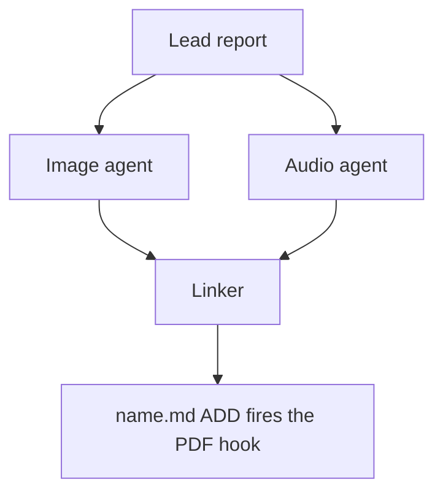

- **PROMPT:** [prompts/202610/research_swarm_mermaid_diagrams.md](https://github.com/sase-org/sase--agents/blob/main/prompts/202610/research_swarm_mermaid_diagrams.md)
- **BEAD:** [sase-1ml](https://github.com/sase-org/sase--beads/blob/main/pages/sase-1ml/README.md)

# Plan: Mermaid diagram handoff from the research_swarm image agent to the linker

## Context

The design comes from the research report
`research:202610/research_swarm_mermaid_handoff_to_linker/research_swarm_mermaid_handoff_to_linker.md`
(read it with `sase artifact read`; if the research checkout does not resolve that
label, read `file:explicit:cae0244aee50638db5d56447`). The user agreed with every
requirement adjustment in that report. This plan turns them into two phases. The
report's section names are cited below when a phase needs the rationale.

Why now: bob's Highlights PDF pipeline renders explicitly tagged ` ```mermaid ` fences
as fitted vector figures (bob-cli `fd3f400b`, pinned Mermaid 12.2.0), and GitHub renders
the same fences natively. A Mermaid block in the published `<name>.md` therefore works
on both reading surfaces with no new renderer and no binary files.

The division of labor:

- **The lead** writes `<name>__final.md` as today. It is never edited.
- **The image agent** proposes diagrams in one companion manifest. The manifest is not a
  report: it holds diagram proposals plus the locators the linker needs.
- **The linker** is still the only publisher. It binds each proposal to lead content
  before restructuring, inserts it verbatim, or omits it with a reason.

All work lives in the linked `sase-research-artifacts` repo. Open it with
`sase repo open sase-research-artifacts -r "<why>"`, use the printed path for every read
and write, and read its `AGENTS.md` first. Verify there with `sase tool run check`,
never bare `just check`. No `sase` or `sase-core` change is needed: nullable `bool`
inputs, `wait.artifacts`, the `agents` outputs namespace, `sase var`, and `#fork`
already exist. A quick render confirmed that `type: bool, default: null` loads and that
`image if diagrams is none else diagrams` evaluates correctly with the installed sase.
`CHANGELOG.md` is owned by release-please, so do not edit it.

## Shared contract

Both phases implement this contract, and their tests pin it.

### Manifest file

- **Path:** `<YYYYMM>/<name>/<stem>.diagrams.md` in the research checkout
  (`$(sase repo path research --ensure)`), beside the lead's report. `<stem>` follows
  the `#research/image` stem rule: strip one trailing `__final`, so `topic__final.md`
  becomes `topic.diagrams.md`.
- **Naming.** A dotted suffix is used, not `_diagrams` or `__diagrams`.
  - Report stems use underscores and hyphens, never dots, so `*.diagrams.md` cannot
    collide with a published report such as `x_diagrams/x_diagrams.md`.
  - `__diagrams.md` would still enter the Research pane inventory, which keeps `__`
    drafts.
- **When written:** only when at least one diagram passed validation. It is written
  without overwrite; on a collision, stop diagram work and report it.
- **Metadata lives in the body, never in frontmatter,** because `sase artifact read`
  strips YAML frontmatter before printing.
- **No local paths or `file:` refs**, because the research repo is public.

Format (the quoted anchor text is illustrative):

````markdown
# Diagram proposals: <report title>

Proposals for the swarm linker, not a report. Each diagram restates only what the source
report says.

```yaml
source: research:<YYYYMM>/<name>/<name>__final.md
producer: research.<N>.image
check: "diagrams: rendered 1 of 1 Mermaid diagrams"
```

## publication-order

```yaml
anchor: |-
  so the link must be in the linker's first commit.
illustrates: |-
  The linker waits for every companion agent because the PDF hook fires once, on the
  ADD of name.md.
caption: The linker publishes once, after every companion finishes.
```


````

Fields:

- **`## <id>`:** a unique lowercase slug per diagram.
- **`anchor`** (required): 5–20 words copied verbatim from _one line_ of a body
  paragraph or list item in the lead's report. It must occur exactly once. Headings,
  table rows, code blocks, and existing Mermaid fences never qualify. It is a YAML
  literal block, so backticks and quotes copy exactly.
- **`illustrates`** (required): one sentence, in the report's own terms, stating the
  point the diagram makes. It is both the linker's fidelity check and its semantic
  fallback locator.
- **`caption`** (required): at most about 15 words. It becomes one italic line under the
  figure and has no figure number.
- **The `mermaid` fence:** exactly the source that passed the render check.
  `accTitle`/`accDescr` are optional.

### Status variable and artifact label

- The image agent **always** runs `sase var set diagrams --json --value '<object>'`,
  including when it proposes nothing. The variable never carries Mermaid bodies:

  ```json
  {"status": "ready", "count": 2, "manifest": "<YYYYMM>/<name>/<stem>.diagrams.md", "source_ref": "<lead ref>"}
  {"status": "none", "count": 0, "reason": "Survey of options; no flow to draw."}
  {"status": "failed", "count": 0, "reason": "bob render check unavailable on this host"}
  ```

- A missing variable means unknown or failed, never "considered and declined".
- When a manifest exists, it is registered with
  `sase artifact create -p "<abs-path>" -l "diagrams:<YYYYMM>/<name>/<stem>.diagrams.md"`,
  without `--move`. The `diagrams:` label keeps it out of every `research:`-filtered
  listing (`_report_records`) while letting the linker filter for it exactly.

### Guardrails

1. **Fidelity:** every box, arrow, and label restates something the report says. There
   are no new actors, steps, numbers, orderings, or causal arrows. Conditional wording
   stays conditional, and proposed designs stay distinct from implemented ones.
2. **Legibility:** a mandatory bob render check, plus size rules for a PDF column about
   650 px wide and at most about half a page tall.
3. **Restraint:** zero to three diagrams, and zero is the normal answer for surveys and
   recommendation lists.
   - Never duplicate the infographic, a diagram the lead already drew, a table, or a
     short list.
   - Never turn a table into a diagram.
4. **Fail-open:** a diagram failure never fails the image agent and never blocks the
   linker. The infographic and the diagrams fail independently.

## Phase manifest-producer: Diagram manifest producer and companion exclusion

This phase ships the producer side and the glob that keeps manifests out of the Research
pane and the Highlights hook. The glob lands in this phase so it is always on master no
later than any code that writes manifests.

### Companion exclusion

- In `src/sase_research_artifacts/provider.py`, add `"!20*/**/*.diagrams.md"` to
  `_COMPANION_MARKDOWN_EXCLUDE_GLOBS`, after `*_narration.md`. That list feeds both the
  `research` inventory and the `research-highlights` hook path globs.
- Update the module docstring to name diagram manifests next to infographic pages and
  narration scripts.
- In `tests/test_provider_specs.py`:
  - extend the expected `path_globs` tuple in
    `test_research_highlights_use_resolves_with_local_command`;
  - add a regression test proving that `202610/x/x.diagrams.md` is excluded from both
    the inventory and the hook;
  - prove in the same test that `202610/x_diagrams/x_diagrams.md` and
    `202610/x/x_diagrams.md` are _not_ excluded.
- Prefer exercising sase's real glob matcher, through whatever public path sase uses to
  evaluate inventory or file-hook path globs. Only if none is importable, fall back to
  an explicit `!`-negation matcher in the test that documents the glob semantics.
- Update the companion-exclusion prose in `docs/configuration.md` (the "base inventory
  deliberately excludes" paragraph) and in `README.md` (the inventory paragraph that
  lists `*_infographic.md` and `*_narration.md`).

### The `#research/diagrams` macro

Create `src/sase_research_artifacts/xprompts/research_diagrams.md` with this
frontmatter:

```yaml
name: research/diagrams
description:
  Propose validated Mermaid diagrams for a swarm lead's research report in a companion
  manifest that the swarm linker places.
```

The macro takes no inputs. It is written for the swarm's image segment, which (after the
next phase) lists the lead's registered report above it. Standalone `#research/image`
stays exactly as it is. Keep the body tight, in the style of `research_audio.md`, and
cover these steps in order:

1. **Scope and source.**
   - Decide whether Mermaid diagrams would help a reader understand the lead's report,
     and if so write them to the manifest for the linker to place.
   - Never edit the report, never write a report of your own, and create no other file
     in the research checkout. Scratch files go in a fresh `mktemp -d` directory outside
     it.
   - Read the report once through `sase artifact read` on the registered lead entry
     listed above (its `ref`, or its `research:` label), redirecting the output to a
     scratch copy. Never work from memory or the forked conversation alone.
   - If no registered lead report is listed, propose nothing and set `status: failed`
     with that reason.
   - If this prompt also asked for an infographic, finish it first and do not repeat
     what it shows.
2. **Decide.** Zero is a normal outcome. Propose a diagram only when all of these hold:
   - the report describes three or more connected parts: a flow, a state lifecycle, an
     exchange between actors over time, a dependency structure, or a phased plan;
   - a reader would grasp it faster from the picture than from the prose;
   - every box, arrow, and label restates the report;
   - the diagram does not repeat the infographic, a Mermaid diagram already in the
     report, a table, or a short list.

   Propose at most three. Include the fidelity rules from the guardrails.

3. **Draw** for a PDF column about 650 px wide and at most about half a page tall.
   - Types: `flowchart` (prefer `TD`; use `LR` only for a chain of five or fewer short
     nodes), `sequenceDiagram` (at most four participants), `stateDiagram-v2`,
     `classDiagram`, `erDiagram`.
   - No `%%{init}%%`, `click`, `style`, `classDef`, HTML, or icons.
   - At most four boxes side by side and about five ranks. In `TD` flows, avoid decision
     diamonds and put the condition on a labelled edge instead.
   - Labels of about four words or fewer, in the report's terms. Quote every label
     (`A["Lead report"]`, `-->|"on failure"|`). Never use `end` as a node id.
4. **Validate** in a scratch Markdown file that has a short paragraph before each
   diagram:

   ```sh
   bob ref create <scratch>/check.md -o <scratch>/check_render.pdf -n -P <parent>
   ```

   - `-n` is `--no-audio`, not a dry run.
   - Writing `-o` outside the library leaves no vault state.
   - The output PDF stem must differ from the Markdown stem.
   - `-P` is required and must name an existing Bob area or project note. Use the SASE
     project's display name (the same value the Highlights hook passes; see
     `sase project current --json`). If bob rejects it, rerun with any note listed by
     `bob capture-targets`. The parent does not affect the check.
   - Every diagram must render (`diagrams: rendered N of N Mermaid diagrams`) with no
     `warning:` lines. Fix, simplify, or drop failing diagrams, and stop after three
     rounds.
   - If bob is missing or the check cannot run, propose nothing and set `status: failed`
     with the reason.

5. **Anchor.** For each kept diagram, choose an anchor that meets the contract. Confirm
   that `grep -cF -- '<anchor>' <scratch-copy>` prints `1`. If no unique anchor exists,
   drop the diagram.
6. **Write** `<stem>.diagrams.md` beside the report, without overwrite, in the contract
   format. `source` is the lead's `research:` label, `producer` is this agent's name,
   and `check` is bob's `diagrams:` line. Each `mermaid` fence must be byte-identical to
   the source that passed the check; rerun the check after any edit. Write no file when
   no diagram survives.
7. **Register and report.**
   - Register the manifest with the `diagrams:` label, without `--move`.
   - Then always set the `diagrams` variable, with `ready`, `none`, or `failed` and the
     fields shown in the contract.
   - A diagram failure never fails this agent. Finish normally so the linker can
     publish, and mention the outcome in the final response.

Before finishing, run the documented bob check yourself against a scratch copy of the
macro's own example diagram. That confirms the command line in the macro is accurate on
this host. Note the result in the phase bead.

### Tests

- In `tests/test_macro_loading.py`, rename `test_all_six_research_macros_load` (and its
  set) to cover seven macros, including `research/diagrams`.
- Add content tests for `#research/diagrams` covering:
  - the stem rule (`topic__final.md` gives `topic.diagrams.md`) and "without overwrite";
  - the `diagrams:` registration command and `sase var set diagrams`, with all three
    statuses;
  - "at most three", the bob check command, and `grep -cF`;
  - the fail-open "finish normally" rule;
  - the rule that metadata stays out of frontmatter, and the no-`file:`-refs rule.
- Assert that `research_image.md` still never mentions diagrams or Mermaid.
- `tests/wheel_smoke.py` and `tests/test_wheel_contract.py`: add `research_diagrams.md`
  and `research/diagrams` to the wheel and sdist member lists and the loaded-macro set,
  renaming the `all_six` test names to match.
- The existing deferred-Jinja-in-inline-code test already sweeps every research macro.
  Keep the new macro free of runtime Jinja.

### Docs

- `docs/macros.md`: add a `#research/diagrams` section after `#research/image`, covering
  purpose, manifest path and format, status variable, label, the validation requirement,
  and fail-open behavior. State that it is meant for the swarm's image segment and that
  standalone `#research/image` stays PNG-only.
- `README.md`: add the macro to the macro list.
- `AGENTS.md`: add the macro to the macros bullet in Architecture.

## Phase swarm-diagram-handoff: Swarm diagrams flag and linker placement

This phase is the consumer side, all in
`src/sase_research_artifacts/xprompts/research_swarm.md`.

### Input and topology

- Add a `diagrams` input after `image_model`: `type: bool`, `default: null`, with a
  description saying it follows `image` when null and that `diagrams=true` implies the
  image segment and the linker.
- Update the frontmatter `description` to mention diagrams.
- Template logic:

  ```jinja
  
  
  
  ```

- Resulting behavior:
  - `image=true` gives the infographic and diagrams;
  - `image=true diagrams=false` gives the infographic only;
  - `diagrams=true` alone runs the image segment with only the diagrams brief;
  - `diagrams=false` alone adds nothing.
- Image segment:
  - gate it with `%if(should_run={{ run_visual }})`, keeping the `%id(image, ...)`,
    `%m:{{ image_model }}`, `%wait:research.{@1}.final`, `#_queue`, and
    `#fork:research.{@1}.final` directives;
  - emit `#research/image` only when `image`;
  - when `run_diagrams`, add a short "The lead researcher's registered report:" block
    rendering `#_report_records`, followed by `#research/diagrams`, so the diagrams
    brief runs second.
- Linker waits: `%wait:research.{@1}.image` whenever `run_visual`, not only when
  `image`.
- `linker_files` tree: add `<name>.diagrams.md` (marked optional) when `run_diagrams`.
  The lead's tree is unchanged.

### Linker inputs (only when `run_diagrams`)

Mirror the audio handoff. Use raw-protected, plain `key=value` loops, never inside
backticks:

```text

- agent={{ key }} diagrams={{ outputs.diagrams }}


- wait_name={{ a.wait_name }} label={{ a.label }} path={{ a.path }} ref={{ a.ref }}

```

### Linker text

Add only when `run_diagrams` unless marked unconditional. Keep each addition short.

- **Preamble:** extend the "only prose you write yourself" sentence to say that the only
  other content you add is the image agent's diagrams and captions, copied verbatim.
- **Step 1.**
  - Read the `diagrams` variable of `research.{@1}.image`.
  - Only when its `status` is `ready`, take exactly one listed `diagrams:` entry from
    `wait_name` `research.{@1}.image` whose label is
    `diagrams:<YYYYMM>/<name>/<name>.diagrams.md` for the lead's own `<YYYYMM>/<name>/`.
    Read it with `sase artifact read`, and confirm its `source` equals the lead's label.
  - Publish with no proposed diagrams, and say why in the final response, if any of
    these holds:
    - the status is `none` or `failed`;
    - the variable is missing;
    - the manifest entry is missing or ambiguous;
    - the source does not match.
  - Diagram problems never stop publication. The existing stop conditions (a missing or
    ambiguous lead, a `<name>.md` collision) are unchanged.
  - Extend "never modify, move, or delete" to cover the manifest.
- **Step 2:** for each manifest diagram, record its ID against the one lead block
  (paragraph or list item) that contains its `anchor`. Mark a diagram whose anchor
  matches zero or several blocks as omitted.
- **Step 3**, a new **Place proposed diagrams** bullet. After restructuring:
  - Insert each fence byte-for-byte directly after the block that now carries the tagged
    content, even if that content was reordered, merged, or converted from a table into
    a list. Follow it with the caption as one italic line, with blank lines around both.
  - Then check that the surrounding final text still states the `illustrates` point and
    that no box or edge contradicts it. Omit the diagram otherwise.
  - Placement rules:
    - never in the fixed opening sequence;
    - never directly under a heading;
    - never inside a list or blockquote: after the whole list instead;
    - bottom-line content goes at the end of that section;
    - two diagrams on one block go in manifest order;
    - never in an appendix.
  - Never edit, redraw, merge, or invent a diagram.
  - A private scratch marker such as `<!-- D:<id> -->` may be used in the working draft
    but must be gone before writing.
  - _Unconditional:_ add "or a diagram" to the list of forbidden table substitutes.
- **Step 6:** every manifest diagram appears exactly once, byte-identical, or is named
  as omitted. _Unconditional:_ every Mermaid diagram from the lead's report is still
  present. Give a fence-count check: lead fences plus accepted diagrams equals the
  published count.
- **Final response:** list accepted and omitted diagram IDs with reasons. Never write
  "diagrams pending".

The opening-order sentence and the infographic slot stay exactly as they are. Diagrams
never enter them. Audio still narrates `__final.md`, so the prose must stay complete
without diagrams.

### Tests

In `tests/test_macro_loading.py`:

- Extend `_without_wait_artifacts_loop` with the two new raw loops, and add constants
  for them, so the "no stray `{%`" queue check keeps passing.
- Update `test_research_swarm_declares_typed_input` for the new input (type `bool`,
  default `None`) and shift any index-based default assertions.
- Replace `"%if(should_run={{ image }})"` expectations with
  `"%if(should_run={{ run_visual }})"`.
- Add a parametrized matrix with `diagrams` unset, `true`, and `false`, crossed with
  `image` true and false. Assert:
  - the segment count;
  - whether `#research/image` and `#research/diagrams` appear in the image segment, and
    in which order;
  - `_report_records` in the image segment only when `run_diagrams`;
  - the linker waits on `.image` exactly when `run_visual`;
  - the linker carries the diagram loops, binding, and placement text only when
    `run_diagrams`;
  - the opening-order text is unchanged;
  - `<name>.diagrams.md` appears in the linker tree only when `run_diagrams`;
  - `plan_typed_launch_units` has no diagnostics;
  - one queue directive per segment.
- Add a launch-time render test modelled on
  `test_research_swarm_linker_renders_audio_handoff_at_launch`. Bind `agents` with a
  `research.m.image` `diagrams` variable, and `wait.artifacts` with a `diagrams:`
  markdown entry. Assert the rendered `agent=` and `wait_name=` lines appear and no
  `{{`/`{%` survives.
- Assert the "or a diagram" substitute ban and the lead-diagrams-preserved rule appear
  even with diagrams off.
- In `tests/wheel_smoke.py`, render one `diagrams=true` swarm, so the published-minimum
  (sase 0.18.0) install smoke proves the nullable `bool` input loads there.

### Docs

- `docs/macros.md`, `#research_swarm` section:
  - add the `diagrams` row to the input table;
  - describe the image segment as running `#research/image` and/or `#research/diagrams`,
    and the linker waiting on it whenever either runs;
  - add a short "Diagram handoff" subsection describing binding, placement, omission,
    and fail-open;
  - add a `diagrams` column or note to the execution matrix, covering the
    `diagrams=true` alone row;
  - name `<name>.diagrams.md` beside the narration script in the exclusions paragraph.
- `README.md`: update the swarm bullet.

### Proposed follow-ups

Record these as `PROPOSED FOLLOW-UP:` notes on this phase's bead:

- **bob-cli:** a vault-free `bob ref diagrams check <file.md> --json`.
  - It reports per-diagram `ok`, `error`, `width_pt`, `height_pt`, and `scale`, flags
    fitted heights above about half the text box, and exits non-zero on failure.
  - It would also fit figures to the text height minus a heading allowance.
  - bob-cli is its own SASE project, so this is out of scope here. Once it exists,
    switch `#research/diagrams` to it and drop the `-P` dependency.
- **Pilot:** after a plugin release and reinstall, measure about 20 swarms:
  - the share of runs with at least one diagram, and the reasons for skipping;
  - linker omissions and their reasons;
  - bob's `rendered N of M` lines and warnings in hook output;
  - the image agent's added runtime.

  Reopen the design under the report's "Rollout and reopen conditions".

## Verification

- `sase tool run check` passes in `sase-research-artifacts` after each phase. Run
  `just test-wheel` too when wheel or sdist member lists change, through `sase tool run`
  if it is guarded.
- After the manifest-producer phase: the provider tests prove exclusion of
  `x/x.diagrams.md` and non-exclusion of `x_diagrams/x_diagrams.md`, and the macro's bob
  check command was run once by hand.
- After the swarm-diagram-handoff phase: the six-way `diagrams` × `image` matrix and the
  launch-time render test pass, and every pre-existing swarm test still passes with only
  intentional expectation updates.
- Not verified by this epic: real swarm behavior. Agents cannot install the plugin
  globally, so end-to-end acceptance happens in the pilot after Bryan releases and
  reinstalls it. The pilot covers these cases:
  - `status: none` and a missing variable;
  - an anchor that matches twice, and a source mismatch;
  - reordering, renamed headings, table-to-list conversion, and merged duplicates;
  - an existing lead diagram, and two proposals on one block;
  - image and audio running together;
  - real figures in the PDF.

## Risks

- **Fidelity drift.** An arrow can assert causality the report never claims.
  Mitigations: the `illustrates` gate, the linker's omit-on-contradiction rule, and
  verbatim-only copying.
- **Tall or tiny figures.** bob does not warn about height. The size rules are the v1
  defense; the bob-cli follow-up adds a measured check.
- **Over-diagramming.** The macro states that zero is the normal outcome and caps
  proposals at three.
- **Prompt growth in the linker.** All diagram text is gated on `run_diagrams`, so
  swarms without diagrams see an unchanged linker apart from two one-line rule
  additions.
- **Image agent crash still parks the linker.** That behavior is pre-existing. Diagram
  work only adds fail-open steps, and both briefs end with "finish normally".
